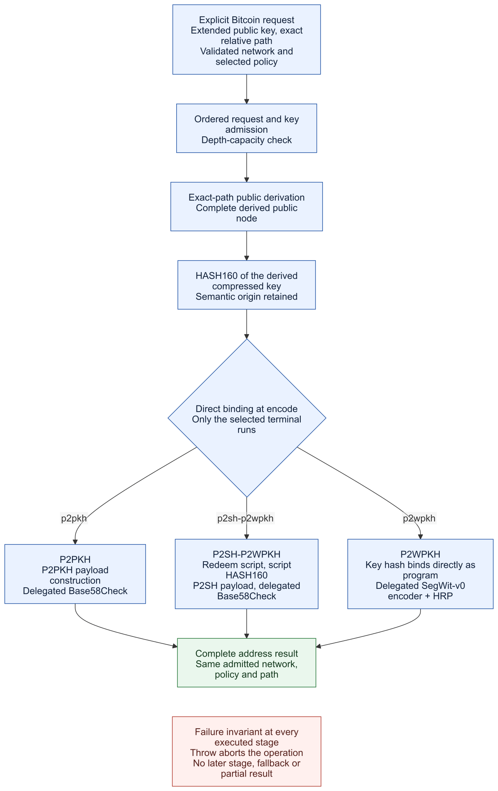
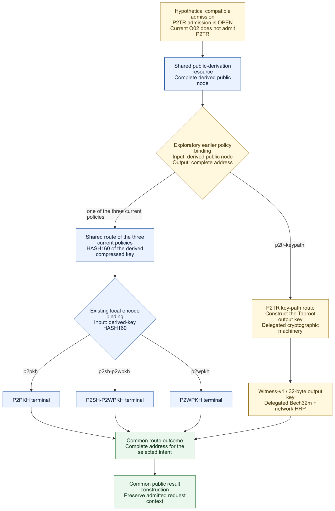
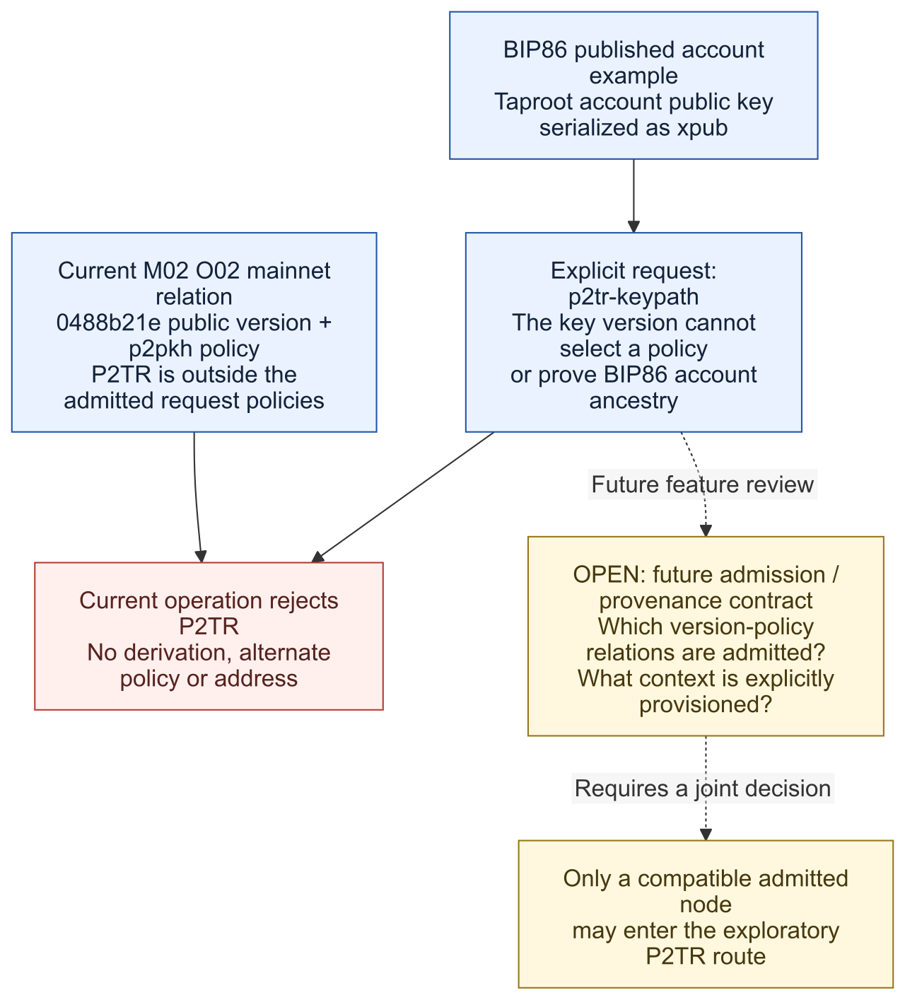
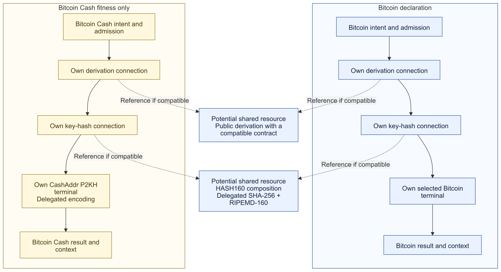
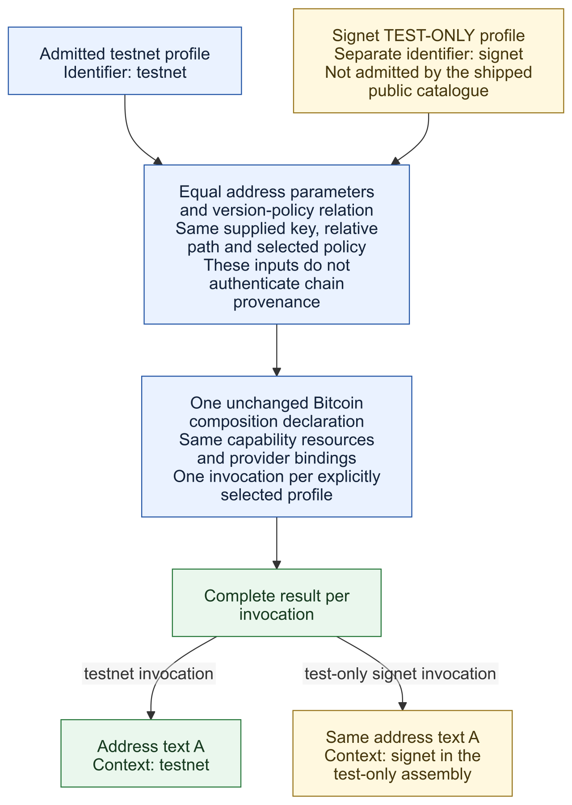
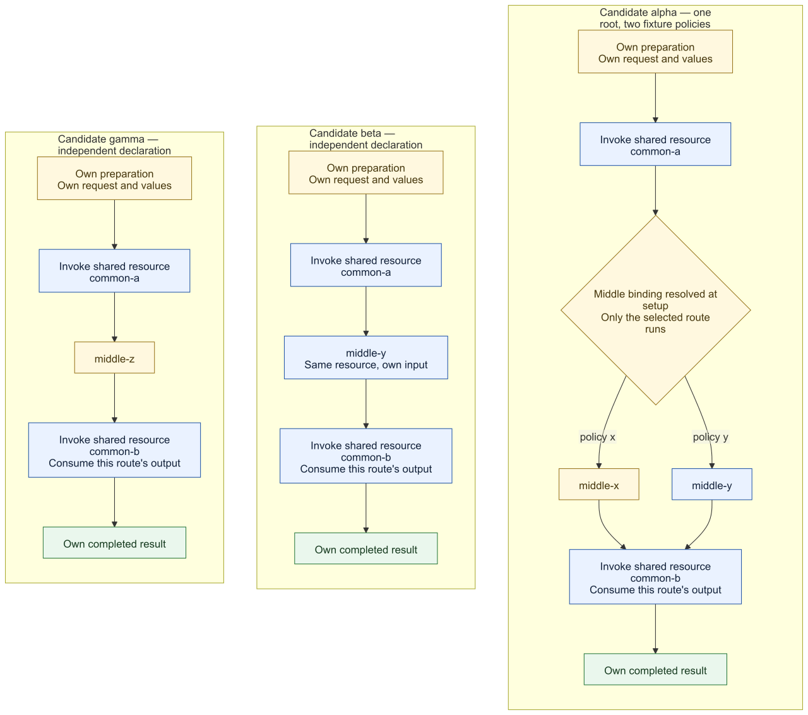

# M05 — Concrete PHP contract proposal

Status: **executor proposal for joint M05 review; not frozen or implemented**.
Origin: [Issue #41](https://github.com/paycrypto-me/paycrypto-me-primitives-php/issues/41).
The [M05 assessment](README.md) owns provider/runtime evidence and selection;
the [Execution Plan](../EXECUTION-PLAN.md) owns ordering and the M06 handoff.
This document proposes PHP representations within the accepted
[M02 O01–O06 decisions](../M02/M02-PROTOCOL.md) and approved
[PIP00010 receiving boundary](../../PIP00010/PIP00010.md). It does not replace
the historical M01 draft or reopen exact-path derivation and public exceptions.

The proposal keeps raw input admission explicit, uses one owned exception with
stable reasons, and introduces immutable objects where retained invariants or
returned context require them. No class is required solely because M01 has a
requirement row. Names below are proposed public identifiers, rooted in
`PayCryptoMe\Primitives`; final file placement follows the concrete capability
responsibility rather than a provider or network hierarchy.

## Reading and decision status

This document contains different levels of authority. **Permission to advance
the draft is not agreement with the executor's proposed choices.**

| Material | Status and how to read it |
|---|---|
| Referenced M02 decisions and approved PIPs | Existing boundaries. This draft does not amend them. |
| [Agreed composition direction](#agreed-composition-direction) | Jointly agreed architectural direction; its flow tables explain the accepted protocol semantics. For the three delivered Bitcoin policies, the selected terminal binds directly to the declared `encode` step under its required contract. Exact C2 source syntax and executor remain open. |
| [Preliminary schema and execution proposal](#preliminary-schema-and-execution-proposal) | **C1 architectural direction consolidated, including its extension review (2026-10-28). C2 is next.** Independent policy flows may select complete declarations without a mandatory Bitcoin-wide root. The three current policies retain their compatible shared route and direct terminal bindings; Taproot fitness has an independent flow using compatible resources. Concrete C2–C6 forms and future admission remain open. |
| Entry points, results, provisioning, concrete exception design and lower PHP signatures | Earlier executor proposals, also awaiting joint review. References to accepted protocol semantics do not approve the proposed PHP packaging. |
| Research links and downstream acceptance cases | Linked probes establish only their recorded scope. Acceptance cases are obligations, not passing implementation tests. |
| [Visual counter-proofs](#visual-counter-proofs-for-joint-review) | Guided comparison of the agreed current scope, the agreed independent-policy-flow relationship and future Taproot admission gap, independent Bitcoin Cash resource reuse, and test-only Signet parameter variation. Diagrams do not settle the open choices. |

For the new material, start with the [choice table](#preliminary-choices-for-joint-discussion),
then examine the schema, full flow and admission rules. A subsequent joint
decision must identify which choices were accepted, revised or deferred; silence,
a documentation merge or a passing documentation check does not settle them.

## Agreed composition direction

The joint design discussion on 2026-10-22 established the following direction
for refining M05. This agreement concerns architecture, not provider/runtime
selection or a freeze of the PHP signatures and schema representation below.
It applies the accepted M02 O05/O06 decisions and the
[Canonical composition and definition boundaries](../../../canonicals/primitives/paycrypto-primitives-canonical-architecture-reference-v1.8.md#8-primitive-composition-principle).
The exploratory cross-protocol examples inform design fitness; they do not
add supported networks, policies or operations.

- Distinct protocol candidates have independent flow declarations: each states
  its own semantic intent, inputs, ordered connections and outputs. The
  declarations may reference the same reusable resources where contracts match;
  each may choose different resources or connections at any position. One
  candidate cannot run through, alias or mutate another candidate's declaration
  to impersonate its flow. Equivalent network/parameter variants
  within one candidate reuse its declaration with validated parameter data.
  Do not hide a flow in a specialized function, method or composition class
  for each coin/network.
- A composition is inspectable data describing capability connections and
  parameter bindings. Each connection must satisfy the next capability's
  semantic input contract, not merely match a PHP type or byte length.
- Declared steps run in their stated order. A step may consume declared
  composition inputs/parameters or outputs of earlier steps, never a future
  step's output. Setup resolves every admitted intent binding and rejects
  circular dependencies among compositions/operations, including a cycle
  completed by an intent-bound step, before returning a usable operation.
  This constrains declaration dependencies, not the internal implementation
  technique of a cohesive capability or its bounded iteration.
- The three delivered Bitcoin address policies share one ordered route through
  admission, exact-path derivation and derived-key HASH160, then take only the
  explicitly selected policy's terminal route. Each terminal declares its
  policy-specific semantic connections and encoding boundary. This is one
  Bitcoin flow with a visible policy junction, not three copies of its common
  route. It does not make the
  key-hash junction universal for later policies or other protocol candidates.
  For this local junction, each admitted intent binds its terminal directly to
  the declared `encode` step, whose required contract is checked at setup.
  The exact source syntax and executor remain design questions.
- **Joint C1 extension criterion (2026-10-27):** policy variation inside one
  protocol candidate is not limited to a single terminal, a fixed step name,
  a fixed nesting depth or a universal post-HASH160 junction. The composition
  mechanism must support multiple semantically justified binding points,
  including nested ones, at the beginning, middle or end of a selected route.
  Independent flows can reuse compatible resources again after divergent work,
  at any position, without exchanging execution data or identity. Reuse is not
  restricted to a shared prefix or terminal.
  Each binding satisfies its local input, parameter and output contract; setup
  resolves the complete ordered route before use. Early binding or nesting must
  not bypass the selected operation's required admission or failure order.
  Extending Bitcoin must not
  require P2TR to impersonate P2PKH, fabricate a key hash, bypass an incompatible
  stage or add a policy-specific branch to the executor. New capabilities,
  adapters, semantic validation rules and admission decisions may still be
  needed and must be qualified. This criterion does not approve the particular
  derived-node-address decomposition or occurrence-path notation explored below.
  **Joint clarification (2026-10-28):** protocol membership does not require a
  common execution root. A policy with a distinct workflow may have its own
  complete composition declaration and directly reuse compatible resources,
  while retaining its protocol/network/policy identity. Taproot is such a
  policy-flow candidate; Bitcoin Cash remains a distinct protocol candidate.
  Their independent-flow/reusable-resource principle is the same. C1's bounded
  extension review is concluded at the architectural level; C2 is next.
- For the delivered terminals, P2PKH declares payload construction then
  Base58Check encoding; P2SH-P2WPKH declares witness-v0 redeem-script
  construction, script HASH160, P2SH payload construction and Base58Check
  encoding. P2WPKH declares one executable SegWit-v0 key-hash encoding step.
  Its derived-key HASH160 output binds directly to the encoder's program input
  under a checked semantic connection, with the selected network's HRP. A
  pass-through capability that merely renames those bytes adds no behavior or
  independent validation guarantee. This does not make arbitrary 20-byte
  values interchangeable with the derived key hash. The exact C2 syntax and
  C3 checking mechanism remain open.
- Each capability fulfills one specific, complete semantic responsibility and
  preserves its invariants. Granularity concerns that objective, not the number
  of functions or internal actions. Cohesion alone does not justify combining
  independently meaningful responsibilities. Declaring composition does not
  require turning every internal instruction into data.
  Each capability is a complete unit for its enclosing composition: it has a
  documented input, outcome and failure contract, and the composition receives
  only that completed outcome or the owned failure. Its internals remain open
  to source review and independent tests, including tests at relevant lower
  provider boundaries. This unit boundary does not promise rollback of
  arbitrary provider side effects. It does not settle which specific
  capabilities or subcompositions the assembled flow should declare.
- Reusable resources include owned capabilities and neutral subcompositions
  with cohesive contracts and semantics independent of any candidate's flow.
  `HASH160` is a candidate for the latter: each declaration connects it using
  its own semantically valid inputs and retains the origin of the resulting
  digest. Shared lower algorithms remain delegated to qualified providers.
  Scope follows responsibility and semantic contract, not a minimum consumer
  count. A cohesive, candidate-independent resource may start shared when its
  first concrete use already establishes a general contract; a second consumer
  is not required. Keep a component local when its purpose or invariants belong
  to a specific flow. When a later concrete use has compatible semantics,
  promote it to a shared resource and update the consuming declarations; do
  not force either candidate through the other's flow. An internal helper need
  not become a declared step merely because code is reused or might be reused.
  This agreement does not select a public resource or extension API. The
  remaining boundaries of specific components belong to C4; how their
  contracts are checked belongs to C3.
- An exception aborts the whole operation. No subsequent stage, substitute
  result, alternate provider, policy, key or index is attempted.

Names are not the architectural constraint. A name such as `BitcoinDefinition`
may describe an appropriate shared protocol schema/value; it is not prohibited
because it contains a coin name. Assess its responsibility and reuse. The
accepted rule still excludes a class per network merely to carry constants,
and a descriptive name must not conceal duplicated behavior or composition.
Ordinary methods may validate data or execute admitted capabilities; their
existence is not the problem.

### Capability responsibility and boundary decisions

**Joint criterion (2026-10-28):** a capability has one specific and complete
purpose within its semantic context. Several actions may be required to fulfill
that responsibility; one action or one function is not the measure of
granularity. Small, related actions must still belong to that responsibility.
Independently meaningful responsibilities do not become one merely because
they are cohesive or contribute to the same broader operation. Composition
connects those responsibilities while preserving their contracts.

For each material C4 boundary, record its specific purpose, inputs, complete
outcome, invariants and failures, and explain why the enclosed work fulfills
that responsibility rather than another independent responsibility. Identify
which contracted resources it consumes and which connections belong in the
flow declaration. A resource having a contract does not automatically require
its invocation to become a separately configurable step; ordinary internal
instructions and helpers are not extracted merely to make the diagram finer.
Inspection and testing remain possible at the relevant internal boundaries.

Executors follow those explicit decisions. An unresolved material boundary is
raised for joint review with the contract and concrete counterexample; it is
not settled independently through a broad interpretation of “cohesion.” These
criteria constrain the remaining C4 choices without approving any specific
admission, CKDpub or Taproot output-key boundary in advance. The proposed
Taproot output-key unit still needs that justification. Existing agreed
terminal splits and resource-scope guidance remain in force.

### Separate data responsibilities

| Record | Meaning and boundary |
|---|---|
| Parameter definition | Immutable identifiers, versions, HRPs and admitted version/policy mappings. No callbacks, providers or execution graph inside `NetworkDefinition`. |
| Composition declaration | Data identifying owned capabilities or reusable subcompositions, their named input/output connections, parameter requirements and operation result. It contains no executable callback or vendor class. |
| Network/policy binding | An explicit association between an admitted intent, a composition and the required parameter definition. Mainnet/testnet reuse the same policy composition. A matching prefix never selects intent. |
| Provider wiring | Explicit setup binds an owned capability contract to one qualified implementation. This remains separate from network data and composition semantics; no availability-based selection. |

Capability contracts supply the meaning and failure rules that declarations
reference. Schemas validate data structure; semantic validation checks the
connections and operation constraints. A declaration cannot override the
contract it references. Its validated representation is immutable and must
not retain mutable caller references.

The initial scope is the compositions required by the approved operations and
six network/policy combinations. This is not approval for an arbitrary public
workflow language or a public extension registry. PHP arrays, typed builders,
schema representation and the execution mechanism remain concrete M05 design
choices. They must preserve visible composition rather than reducing every
declaration to a pointer to a coin-specific implementation.

### Concrete flow and semantic connections

For the delivered Bitcoin policies, the shared public flow has ordered
request/definition admission, extended-key admission, remaining-depth
validation, exact-path public derivation and key HASH160 before the selected
terminal composition. Extended-key admission
retains the visible substeps in [validation order](#failure-contract-and-validation-order):
checked decoding and common metadata, version eligibility, point validation,
then intent compatibility. Neither a graph scheduler nor a builder may reorder
them. Only the explicitly selected policy branch runs.

| Connection | Meaning required by its consumer |
|---|---|
| Request to key admission | Original serialized public key and validated explicit network/policy intent; no inferred intent or coerced path values. |
| Key admission to exact-path derivation | A complete admitted public node, including chain code, version and metadata; a compressed key alone is insufficient. The validated path must also fit remaining depth. |
| Derivation to key hashing | The final admitted compressed public key from the exact requested path. The full node remains the derivation result; hashing uses its public-key field. |
| Key hashing to terminal composition | A 20-byte HASH160 of that derived compressed key, with that semantic origin. An arbitrary 20-byte digest is not interchangeable. |
| Terminal composition to public result | A complete address for the same admitted intent and path; result context comes from the validated request, not encoding-based inference. |

HASH160 is a reusable composition of delegated SHA-256 followed by delegated
RIPEMD-160, with binary 32-byte and 20-byte results respectively. Reusing it
does not erase whether its input is a public key or a witness redeem script.
Those semantic origins remain explicit at the surrounding connections.

| Policy | Shared input | Owned construction and parameter binding | Delegated terminal encoding |
|---|---|---|---|
| `p2pkh` | Derived compressed-key HASH160 | The admitted network's P2PKH version byte followed by the key hash. | Base58Check of the complete 21-byte payload. |
| `p2sh-p2wpkh` | The same key-hash semantics | Form the 22-byte witness redeem script `0x00 0x14` followed by the key hash; apply HASH160 to that script; prepend the admitted P2SH version byte. | Base58Check of the complete 21-byte payload. |
| `p2wpkh` | The same key-hash semantics | Bind that hash as the witness-v0 20-byte program and the admitted network's HRP. | The qualified SegWit-v0 key-hash encoder. |

This table exposes the shared prefix and actual terminal divergence without
making one class per policy a requirement. P2PKH key hash, P2SH script hash and
witness program can have the same byte length while requiring different
connections. The supported compositions fix these relationships; a generic
byte concatenator or `mixed -> mixed` stage interface cannot establish them.
Standardized hashing and encoding machinery remains delegated. Owned fixed
payload/script construction does not introduce a general script engine.

The receiving operation adds ordered account/index admission and exact
network/policy/account source selection, then invokes the same generic
operation with the selected serialized key and `[0, index]`. Its result adds
the logical account, branch `0` and index. This boundary is itself inspectable;
it must not hide another derivation flow or bypass generic key admission.

### Schema and execution obligations

The schema must make these fields or equivalent semantics reviewable: a
composition identifier, required inputs/parameters, capability or
subcomposition references, named connections, ordering constraints and result
bindings. Exact PHP field names and syntax are not frozen by this list.

1. At setup, reject duplicate identifiers/bindings, unknown references or
   fields, missing inputs, cycles and connections with incompatible semantic
   types. Reject partial or ambiguous assembly before provider execution.
2. Check operation invariants beyond structural validity: the exact admission
   order, complete-node derivation, policy-specific payload construction,
   matching parameter roles, and same-request result context. No declaration
   may skip validation, convert a script hash into a key hash by relabeling,
   introduce an extra executable branch or change exact-path semantics.
3. Freeze the fully validated composition before serving requests. Bind one
   provider per required contract explicitly. Equivalent parameter variants
   within one protocol candidate reuse its declaration; provider replacement
   leaves its semantics unchanged.
4. At execution, enforce actual value contracts at the capability boundaries.
   Static connection validation is not proof that a provider returned correct
   bytes. Independently anchored qualification still detects plausible wrong
   outputs that runtime shape checks cannot establish as wrong.

Composition and binding data errors use the proposed `INVALID_DEFINITION`
category at setup. Provider/environment failures retain their categories.
Malformed request data keeps its request-stage category; declaration errors
must not become delayed request failures.

Failure abort is an operation invariant, not a configurable `on_error` policy.
Adapters normalize vendor conventions at their owned boundary; the executor
propagates owned failures without replacing their semantic reason. No catch
handler may turn failure into `null`, a default address, a partial result or
another execution attempt. The caller handles the public exception. No
failure-path schema fields enable fallback, skip, retry or index advancement.

The documented point capability's `null` for confirmed infinity is a specific
internal outcome, not a continuation value. CKDpub immediately translates it
to `INVALID_CHILD` and terminates; it never reaches an address-construction
stage. Zero tweak remains a valid input with complete child metadata updates.

## Preliminary schema and execution proposal

**This section retains executor proposals for discussion.** It was advanced at
the user's request before joint alignment on the concrete design. The agreed
requirements above and choices explicitly marked as joint decisions remain
constraints; the other representation, mechanism, identifier and responsibility
choices below are not additional agreed decisions.
The section ends at [Entry points and results](#entry-points-and-results).

### Preliminary choices for joint discussion

| Choice | Initial recommendation and reason | Alternative, cost or unresolved question |
|---|---|---|
| C1 — Execution model | **Architectural direction agreed; extension review concluded (2026-10-28).** Distinct flows retain their own declarations and share compatible resources at any position. Protocol membership does not impose one execution root. The three delivered policies share their compatible route and directly bind their terminals; the hypothetical Taproot policy has its own complete flow. Declared order, semantic connections, full setup resolution, cycle rejection, failure abort, single-responsibility capabilities and independent audit remain agreed. | C2 is next: choose concise authoring and immutable representation preserving these relationships. C3 owns compatibility, C4 concrete component boundaries, C5 provisioning/extension and C6 assembly/execution/inspection. The [independent-policy-flow direction](#independent-policy-flow-declarations--agreed-c1-direction) supersedes the mandatory shared-root recommendation. Source names, helper grouping and new feature admission are not frozen. |
| C2 — Authoring and representation | Duplicate-observable PHP pair lists as source; load into private immutable records and resolved references. Reuse the existing provisioning proposal and avoid adding a serialized configuration language. | The pair-list example is hard for human readers to scan and must not stand in for the agreed connection semantics. Typed builders or another concise source form could improve authoring if they retain duplicate detection and yield the same inspectable data. Representation remains open. |
| C3 — Semantic compatibility | **Agreed requirement:** deterministic stage contracts with semantically unambiguous inputs, outputs and failures; connections must preserve actual producer lineage and parameter roles, not merely PHP shape or caller-written labels. **Still proposed:** a closed owned-contract catalogue with narrow lineage checks for this slice. | Shape-only validation is insufficient. The bounded contract metadata/checker design, minimum useful internal value types, point-infinity outcome form and runtime boundary checks need PHP feasibility and joint review. A general refinement/type-expression language needs separate justification. |
| C4 — Composition granularity | **Joint responsibility criterion:** one specific, complete semantic objective per capability; multiple internal actions may serve it, while cohesion does not merge independent responsibilities. Apply the [boundary-decision criteria](#capability-responsibility-and-boundary-decisions). **Joint terminal direction:** P2PKH declares payload construction then Base58Check; P2SH-P2WPKH declares redeem-script construction, script HASH160, P2SH payload construction then Base58Check; P2WPKH binds the derived key hash directly to one SegWit-v0 encoder step with the correct HRP, without a pass-through `program` step. **Still proposed:** keep key admission and exact-path CKDpub cohesive with ordered invariants in their contracts, and declare HASH160, shared address derivation and receiving composition as data. | Automatically exposing each parse or CKDpub instruction would confuse instruction count with semantic responsibility. Moving the entire address flow into one capability would hide the connections we agreed to inspect. The P2WPKH connection still needs semantic-lineage and runtime-shape checks; exact C2 syntax and C3 mechanism remain open. Review the remaining proposed boundaries against actual adapter code before freezing them. |
| C5 — Ownership and extension | Ship a closed composition catalogue. Consumers provision admitted network/account data; provider wiring is explicit and separate. No public arbitrary composition-loader API in this slice. | A public extension registry introduces compatibility, validation and support commitments beyond the current operations. Internal data still must undergo validation; being repository-owned is not proof of correctness. Future extension remains a separate design question. |
| C6 — Setup and runtime | **Agreed behavior from C1:** follow the declared order, execute only the selected route and abort without fallback, later stages or partial public results. **Still proposed:** validate and resolve a complete assembly once, use a fresh invocation frame and execute the selected plan synchronously through an interpreter. The concrete auditor inspection/instrumentation mechanism remains open. | A scheduler may not reorder or speculatively execute stages in violation of C1. Straight-line generated PHP, compilation and caching remain possible mechanisms or optimizations if they preserve the same validation, selection, failure and audit behavior; evaluate benefit and equivalence before adoption. No benchmark or working executor establishes a preference yet. |

These choices are separable. C1's agreed base and extension criterion do not approve pair-list authoring,
the concrete checker, remaining component splits, executor or public API.

**Agreed C1 contract criterion; concrete forms remain under C3:** the complete
selected chain must be deterministic for admitted inputs, definitions and bound
capabilities. Each stage must have unambiguous, semantically named inputs and
outputs and a documented failure meaning; an unconstrained `mixed -> mixed`
stage or a heterogeneous return that makes success, absence and failure
indistinguishable would defeat connection validation. This does not yet settle
the concrete PHP signatures. The `mixed` values proposed at raw public ingress
preserve original types for admission; the proposed point capability's `?string`
has one documented internal infinity outcome. Whether that outcome is clearer as
an explicit type remains open under C3 and the lower PHP contract review.

The caller-facing outcome must be stable, complete and atomic for one admitted
request: either the documented result with all its context, or a documented
owned failure, never a partial value or an unresolved state that the consumer
must interpret to discover what happened. A failed stage must not publish a
later result or mutate an already returned result. This is an operation-result
guarantee, not an unreviewed promise to roll back arbitrary external provider
side effects. Review which internal outcome forms, including nullable ones,
preserve this clarity; no blanket prohibition is decided here.

The whole chain must also be open to inspection, independent validation and
reproduction, down to relevant component contracts and connections. The
[repository audit principle](../../../README.md#auditable-by-design) already
requires independently checkable protocol behavior. **Joint C1 boundary:**
independent auditors can examine and reproduce the behavior; ordinary consumers
are not required to collect or interpret evidence from each invocation to use
the documented result or owned failure. This does not weaken the operation's
complete, atomic caller-facing outcome or preclude a separately justified
diagnostic facility.

**Joint C1 audit direction:** an external reviewer must be able to inspect the
source declarations, resolved connections, owned contracts and the mapping from
each declared step to the capability and selected implementation/dependency
used by the assembled operation; reproduce behavior from a pinned code
revision, dependency/runtime environment, inputs,
commands and independently justified expected outputs; and challenge
selection, ordering, connection validation and failure abort by substituting
test capabilities at the contract's existing boundaries. These challenges
must exercise the same validator and executor used for the operation, not a
second audit-only implementation. Separate tests of cohesive capability
internals and independent protocol vectors or differential references check
behavior that an instrumented composition test or a static schema cannot prove.
The reviewer may choose any component boundary for deeper inspection, whether
Primitives-owned, native to the runtime or supplied by a dependency. The
architecture must not obstruct that choice or make risk ranking an execution
rule. Trust in a native algorithm does not establish that the operation passes
the correct bytes, chooses the correct facility or connects its result to the
right consumer. Provenance and reproducible-build evidence identify what was
examined; they do not establish protocol correctness by themselves. No fixed
audit priority, per-component audit label or mandatory review technique is
selected here.
The independent review records its scope, reproduced evidence, challenges and
limits in the existing durable Issue/PR/CI trail where sufficient. Test doubles
do not qualify production providers or authorize runtime provider fallback.

Remaining subcomposition boundaries require C4 joint review, while their
contract-checking mechanism belongs to C3. The exact PHP auditor
inspection/instrumentation mechanism belongs to C6; any need for
execution-specific qualification evidence remains open for M06/M07 feasibility
and acceptance review. No production audit mode or consumer-facing trace is
required by this direction. In counter-proof evidence, a checksum can pin the
exact external specification/vector snapshot or test artifact used,
detect later alteration and help another reviewer reproduce the comparison.
Together with source provenance and independently justified expected results,
this supports the [canonical CP-11 independent-evidence gate](../../../canonicals/primitives/paycrypto-primitives-canonical-architecture-reference-v1.8.md#cp-11----independent-evidence-and-verification).
The checksum authenticates neither the source's authority nor the protocol
meaning of an output on its own. No public introspection API, mandatory
checksum scheme or additional coupling is selected by this direction.

### Synthetic terminal-junction comparison — C1 decision evidence

The runnable [junction probe](probe-terminal-junction.php) compares the two
representations recorded as interim candidates in
[Issue #41](https://github.com/paycrypto-me/paycrypto-me-primitives-php/issues/41#issuecomment-6390789895).
It uses readable in-memory PHP arrays and symbolic stage outputs. It does not
implement a production loader, cryptography, encoders or the public operation.
This source shape is a probe convenience, **not approval of C2 syntax**.

Both forms keep the *same* `bitcoin-public-address` declaration, with the
ordered steps `admit -> depth -> derive -> keyhash -> encode -> result`.
`encode` consumes `keyhash.digest` as a **derived-public-key hash**, receives
the admitted network definition and yields an address for that admitted intent.
Both forms reference the same three policy-specific terminal compositions and
reuse each one for mainnet and testnet. The relevant source difference is:

```text
                            Named slot                     Direct step binding
Shared declaration          slots: terminal requires      encode requires
                            key-hash-address               key-hash-address
encode target               slot:terminal                  intent-step:encode
P2PKH intent binding        slot terminal ->               step encode ->
                            p2pkh-address                  p2pkh-address
```

The slot form gives the variable position its own `terminal` identifier and
contract declaration. The direct form identifies the already declared `encode`
step and carries the **same required contract there**. Its intent row binds
that step directly to `p2pkh-address`, `nested-witness-address` or
`native-witness-address`. This is still a declared, validated connection; it
is not an executor switch on a coin name or a bypass around semantic checking.
In the probe, binding lists preserve duplicate records until validation. The
selected network/policy row is resolved before symbolic execution; no request
value selects a terminal by prefix, and there is no default terminal.

| Counter-probe, applied to both forms | Observed synthetic result |
|---|---|
| Six explicit mainnet/testnet policy rows; invoke testnet P2SH-P2WPKH | The trace includes the common steps, only `nested-witness-address`, then `result`. |
| Remove a row; duplicate an intent; omit, duplicate or reference an absent terminal binding | Assembly rejects before execution. The duplicate is observable because bindings are list entries. |
| Bind P2PKH to the nested-witness terminal; alter its input contract or network parameter role | Assembly rejects the wrong policy, incompatible input or wrong `p2pkh-version` role. Equal byte lengths cannot establish compatibility. |
| Relabel the HASH160 output as an unqualified digest; bypass `keyhash.digest`; weaken the junction contract | Assembly rejects the lost origin, broken connection or weakened contract. |
| Inject a failure at `keyhash` or the selected terminal | The symbolic trace ends there: no result, other terminal or alternate attempt. |

Run from the repository root with PHP 8.3 or later:

```sh
php docs/pips/PIP-0003/M05/probe-terminal-junction.php
```

On PHP 8.3.36, each form admitted six intents, produced the selected-route and
abort traces, and rejected **11 invalid fixtures**. These are bounded checks of
the *junction representation*. They do not prove the eventual loader rejects
every malformed PHP field or graph, that runtime values satisfy semantic
lineage, that provider exceptions are sanitized, or that address outputs are
correct. The probe deliberately fixes the agreed Bitcoin route and terminal
contracts; changing those rules requires more than swapping the binding form.

**Joint C1 decision following the comparison:** with one variable `encode`
step, the slot record did not demonstrate an additional validation guarantee.
It adds a second identifier (`terminal`) for the same junction already located
by `encode`. Use a direct per-intent binding to that declared step, with its
required contract and connection semantics inspectable and validated. This
settles the local **C1 junction representation**, not the exact C2 PHP source
syntax, loader or public API. A named slot may be evaluated for a future
independently meaningful variation point; this decision adds no general ban.
The exploratory Bitcoin Cash and Taproot cases below challenge *where* a
candidate's own declaration diverges; neither must be forced through this
Bitcoin post-HASH160 junction.

### Preliminary source schema and immutable form — C1/C2/C5

The proposed C2/C5 source form must preserve the agreed C1 constraints and
preserve the [concluded extension-review criteria](#c1-extension-review--concluded-architectural-direction).
Propose the following **internal** source grammar. `Record` means a PHP list
of exact `[field, value]` pairs; every listed field is required exactly once,
including empty lists where applicable. Unknown or duplicate fields fail.
Identifiers are nonempty ASCII strings matching `[a-z][A-Za-z0-9-]*`, scoped to
their containing catalogue/record. All collections below are lists, not maps
that may have overwritten duplicates. No JSON/YAML parser or executable PHP
file loader is part of this proposal; assembly receives data already in memory.

| Record | Exact fields and constraints |
|---|---|
| Composition | `id`: unique identifier; `contract`: owned catalogue identifier; `inputs`: port records; `parameters`: port records; `steps`: nonempty ordered step records; `outputs`: binding records. Contract input/parameter/output names must match exactly. |
| Port | `name`, `type`: identifiers. The type must exist in the owned catalogue and match the composition contract. A source cannot define new types or change their meaning. |
| Step | `id`; `target`: exact `[kind, identifier]`; `inputs`, `parameters`: binding-record lists. Kinds are `capability`, `composition`, `intent`, or `operation`. For `intent`, the identifier is the required owned subcomposition contract and the intent row must bind this step exactly once. The last kind permits only the receiving-to-generic call in this slice. |
| Binding | `port`: destination name; `source`: one reference below. Bind every required destination exactly once; reject extras. Output bindings use this same record and the composition's declared result ports. |
| Intent target | `step`, `composition`: identifiers. The named step must have an `intent` target, and the selected composition must satisfy its required contract. |
| Intent binding | `network`, `policy`, `composition`: identifiers; `targets`: list of intent-target records; `parameters`: binding-record list. Exactly one row per admitted network/policy tuple, with no duplicate rows even if identical. Each intent-target step binds exactly once; unknown, duplicate and absent targets fail. |

**C2 representation gap identified by the C1 review:** this original local-step grammar
does not yet specify how nested binding identity is authored or scoped. The
probe explores occurrence paths separately. Do not implement the table as a
complete schema until that C2/C6 question is resolved; do not interpret bare
step names as global identifiers.

Source references have only these exact tuple forms:

```text
['input', inputName]
['parameter', parameterName]
['output', earlierStepId, outputPortName]
['field', reference, advertisedFieldName]
['network']  // intent bindings only: the admitted NetworkDefinition
```

In `field`, `reference` is exactly an `input`, `parameter` or `output` tuple;
nested field traversal is disallowed. It projects one immutable field
advertised by its producer's contract,
not an arbitrary property path or method call. For example, the complete-node
contract advertises `publicKey`; its projection retains the node's derivation
origin. No literal-value, cast, expression, callback, environment-variable or
container-service reference exists in this grammar. The network reference resolves
the admitted definition; projection retains its field roles. Protocol constants
such as receiving branch `0` and witness version `0` belong to owned contracts,
not to changeable literals in composition data.

Each step can consume only declared inputs/parameters and outputs of earlier
steps in the same composition. Subcompositions have isolated names and receive
only their declared ports. Reject recursive composition/operation references,
self references, forward references and unknown fields/ports. Intent targets
are resolved before traversal, so they cannot conceal a cycle. Declaration
order is execution order; the loader does not repair or topologically reorder
a rejected declaration. Record-field order is immaterial; step order is not.

For human review, the HASH160 connections can be read conceptually as:

```text
input.bytes -> sha.bytes
sha.digest -> ripe.bytes
ripe.digest -> composition.digest
```

This is a view of the agreed output-to-input relationships, not a source syntax.
The following complete **source-shape example** is one preliminary C2 candidate,
not the definition of C1 or an executable implementation. Its verbosity is an
open design concern; it may be refactored or replaced during joint review:

```php
[
    ['id', 'hash160'],
    ['contract', 'hash160'],
    ['inputs', [[['name', 'bytes'], ['type', 'binary-bytes']]]],
    ['parameters', []],
    ['steps', [
        [
            ['id', 'sha'],
            ['target', ['capability', 'sha256']],
            ['inputs', [[['port', 'bytes'], ['source', ['input', 'bytes']]]]],
            ['parameters', []],
        ],
        [
            ['id', 'ripe'],
            ['target', ['capability', 'ripemd160']],
            ['inputs', [[['port', 'bytes'], ['source', ['output', 'sha', 'digest']]]]],
            ['parameters', []],
        ],
    ]],
    ['outputs', [[['port', 'digest'], ['source', ['output', 'ripe', 'digest']]]]],
]
```

The catalogue defines `sha256` as binary input to a 32-byte digest and
`ripemd160` as binary input to a 20-byte digest, with the delegated behavior
and failures already described below. `hash160` declares no new algorithm.
Its contract requires exactly this ordered connection, not any operation
ending in 20 bytes. A caller-written `contract = hash160` label cannot certify
an unrelated declaration. The semantic check inspects its resolved steps.

The loaded form would contain private immutable `Composition`, `Step`,
`PortBinding` and `IntentBinding` records (names provisional), with references
resolved to owned catalogue entries and intent-target/frame positions. Their constructors
are not a public bypass around admission. Rebuild scalar leaves before retaining
them; reject mutable objects in source data. Provider instances occupy a
separate explicit assembly, not these data records. No universal public
`Stage::run(mixed): mixed` contract is proposed: dispatch calls the narrow
capability interfaces, even if an internal interpreter uses a private frame.

### Preliminary complete composition and intent bindings — C3/C4

The following tables specify the other declarations at port level. They are
readable expansions of the grammar, **not additional approved PHP APIs**.
`$name` denotes an input, `@name` a parameter and `step.port` an earlier output;
`derive.node.publicKey` abbreviates the permitted `field` reference. Every
unlisted parameter/target list is explicitly empty when encoded. Each table row
is one step in execution order.

Ports name semantic connections, not new overloads of the PHP signatures
below. For example, dispatch to `ExtendedPublicKeyAdmission::admit` extracts
the admitted request's original key text, definition and policy into its three
arguments. A fixed owned invocation mapping performs this projection; source
data cannot name a PHP class/method or invoke an arbitrary function. Similar
mapping supplies `CkdPublicDerivation` with the complete node and checked path.
Concrete internal helper names remain part of C4 review.

The proposed `public-address` declaration takes one `request` input of type
`admitted-public-request`, has an `encode` step requiring the
`key-hash-address` subcomposition contract, and a `network` parameter of type
`network-definition`. Each admitted intent binds this step directly to one
terminal composition. The operation's raw
request capture preserves original argument types; it performs no decoding
or coercion.
The public method cannot look up a plan using unvalidated caller values.
Its fixed admission prefix validates definition, path, policy and key-text
shape in the documented order. Only then does it select the matching binding
and execute this shared body, whose input is the admitted `request`:

**Scope correction from the C1 extension review:** this body belongs to the
three delivered policies, not a universal Bitcoin route. Its HASH160 is valid
for them; an independent P2TR flow must not call or adapt this key-hash flow.
The [agreed independent-flow direction](#independent-policy-flow-declarations--agreed-c1-direction)
supersedes the later shared-root candidate. These table names/groupings and
the six local bindings below remain C2/C4 examples, not reserved executor
stages or a required topology for other policy declarations.

| Step / target | Named inputs and parameters | Output and required meaning |
|---|---|---|
| `admit` / capability `extended-public-key-admission` | `request = $request` | `node`: complete imported node admitted for the request's explicit intent. Internally: checked decode/common metadata, version eligibility, point validity, intent compatibility, in that order. |
| `depth` / capability `remaining-depth` | `node = admit.node`, `request = $request` | `path`: the unchanged request path, checked against this imported node's remaining depth. No HMAC or ECC derivation. |
| `derive` / capability `ckd-public-path` | `parent = admit.node`, `path = depth.path` | `node`: complete final node from exactly that parent and path. No nullable/partial node. |
| `keyhash` / composition `hash160` | `bytes = derive.node.publicKey` | `digest`: HASH160 of that derived compressed public key. |
| `encode` / intent-bound `key-hash-address` | `keyHash = keyhash.digest`; `network = @network` | `address`: selected policy's complete address under the same network binding. |
| `result` / capability `public-address-result` | `request = $request`, `address = encode.address` | `result`: the complete immutable public result; output binding is `result.result`. |

**Representation detail still preliminary:** represent the fixed raw admission
prefix as an operation-contract prelude, referenced by `public-address`, and
the table as its admitted body. Its catalogue entry must show the prelude and
body together; it must not disguise admission as an implicit executor behavior.
The public operation contract binds the raw entry signature to that exact
prelude and body. The body cannot bypass the prelude through a public API.
An alternative is a top-level operation declaration containing both;
that would need an explicit selection construct. This prelude/body boundary
is a substantive C4 discussion point, not a settled exception to inspectability.

Each terminal implements `key-hash-address`: input `keyHash`, parameter
`network`, output `address`. It receives the immutable definition and projects
only the parameter roles it needs. Here `@network.p2pkhVersion` abbreviates
`['field', ['parameter', 'network'], 'p2pkhVersion']`; the other fields follow
the same rule. The catalogue distinguishes `p2pkh-version`, `p2sh-version` and
`segwit-hrp` by role and origin, not merely PHP string shape. Passing the whole
semantic definition keeps the terminal-step contract uniform but exposes more parameters
than each terminal needs; narrower role-specific bundles are an alternative
to discuss under C3. Neither choice permits an arbitrary parameter bag.

| Declaration | Ordered steps, exact input connections and output binding |
|---|---|
| `p2pkh-address` | `payload`: owned `p2pkh-payload(keyHash = $keyHash; version = @network.p2pkhVersion)` returns the 21-byte P2PKH payload. `encode`: delegated `base58check-encode(payload = payload.payload)` returns `address`; export `encode.address`. |
| `nested-witness-address` | `script`: owned `witness-v0-keyhash-script(keyHash = $keyHash)` returns the 22-byte `0014` redeem script. `scripthash`: composition `hash160(bytes = script.script)` returns `digest`. `payload`: owned `p2sh-payload(scriptHash = scripthash.digest; version = @network.p2shVersion)` returns the 21-byte P2SH payload. `encode`: the same `base58check-encode(payload = payload.payload)`; export `encode.address`. |
| `native-witness-address` | `encode`: delegated `segwit-v0-keyhash-encode(program = $keyHash; hrp = @network.segwitHrp)` returns `address`; export `encode.address`. The direct `keyHash -> program` connection is valid only for the selected P2WPKH terminal and the derived-key HASH160 lineage. |

The payload/script constructors own protocol meaning and fixed layout; they
are not configurable byte concatenators or reimplementations of codecs.
The witness-program role is a checked connection, not a standalone executable
conversion. Setup must verify that the source is the derived-key HASH160 bound
to the selected P2WPKH intent, and that the HRP comes from the selected
definition's SegWit role. Runtime checks still reject an invalid digest shape
at the HASH160/encoder boundaries. No extra failure or successful output is
introduced between those boundaries; M06/M07 must challenge this preserved
admission and failure order through the actual validator and executor.

Proposed intent-binding data, with no implicit rows or policy inference:

| Network | Policy | Shared composition | `encode` step target | Parameter projected inside terminal |
|---|---|---|---|---|
| `mainnet` | `p2pkh` | `public-address` | `p2pkh-address` | `version <- network.p2pkhVersion` |
| `testnet` | `p2pkh` | `public-address` | `p2pkh-address` | `version <- network.p2pkhVersion` |
| `mainnet` | `p2sh-p2wpkh` | `public-address` | `nested-witness-address` | `version <- network.p2shVersion` |
| `testnet` | `p2sh-p2wpkh` | `public-address` | `nested-witness-address` | `version <- network.p2shVersion` |
| `mainnet` | `p2wpkh` | `public-address` | `native-witness-address` | `hrp <- network.segwitHrp` |
| `testnet` | `p2wpkh` | `public-address` | `native-witness-address` | `hrp <- network.segwitHrp` |

In the preliminary pair-list notation, the shared `encode` step has
`['target', ['intent', 'key-hash-address']]`. A P2PKH intent row binds it with
`['targets', [[['step', 'encode'], ['composition', 'p2pkh-address']]]]`.
The step ID identifies the existing junction; no separately declared slot or
default target is involved. These tuples illustrate the agreed relationship,
not an accepted C2 authoring syntax.
This local-only target example is incomplete for the agreed nested-binding
fitness requirement. Repeated names such as `encode` in different compositions
must not collide or capture one another. The source format must identify the
intended scope; the probe's occurrence paths are one unaccepted notation for
doing so, not a requirement to expose verbose paths in human-authored data.

Every intent row supplies the shared composition's `network` parameter using
the binding record `[['port', 'network'], ['source', ['network']]]`.
The last column shows the terminal's subsequent projection, not another
intent-record field. At request admission the supplied definition must be
semantically equivalent to that binding's definition; identifier equality alone
does not admit different parameters. Equivalent independent instances remain valid.
No repeated policy implementation exists per network. Selection yields one
resolved plan; all other policy plans remain unexecuted. The future Signet
counter-proof supplies a test-only definition and three analogous bindings
to the same compositions, without expanding the shipped catalogue.

These six rows describe the completed M07 surface. An M06 assembly advertises
only its implemented first policy on both networks and explicitly rejects the
remaining policies. It must validate all bindings it advertises, rather than
claiming all six network/policy combinations with missing providers or lazy failures.
Adding the remaining supported rows is a later implementation increment, not
a runtime fallback or a change to the target semantics.

Receiving has its own raw admission prelude (network, account, index, policy)
and one admitted body, bound to the immutable source and generic operation
at assembly. It has no intent-bound terminal step and takes no caller branch parameter:

| Step / target | Named connections | Output and required meaning |
|---|---|---|
| `select` / capability `account-key-selection` | `request = $request`; source is an explicit assembly dependency | `key`: exact tuple's original serialized key, or missing-mapping failure. |
| `request` / capability `receiving-public-request` | `request = $request`, `key = select.key` | `generic`: raw generic arguments with the same network/policy, selected key and exact `[0, index]`; no decoding or derivation. |
| `generic` / operation `derive-public-address` | `request = request.generic` | `result`: invoke the same public operation including its full raw admission prelude and selected declared body. No admitted-node shortcut. |
| `result` / capability `receiving-address-result` | `request = $request`, `generic = generic.result` | `result`: complete address and original logical account/branch/index, after checking generic context/path agreement; export `result.result`. |

The receiving declaration is not replicated for six tuples. It delegates
selection of the generic body to the same explicit intent table. The only
variable-length iteration is CKDpub's already bounded exact path inside its
owned capability; this schema adds no loops, branching predicates, retry
instructions or arbitrary operation calls.

### Preliminary semantic admission and execution — C3/C6

Propose three admission passes followed by one execution rule:

1. **Source shape and references:** validate all records and duplicates before
   normalization; resolve catalogue references and intent-target bindings, reject cycles,
   missing/extra ports, forward references and unavailable required bindings.
   No cryptographic/codec work occurs. Check every shipped intent binding,
   not merely the first request's branch.
2. **Operation semantics:** check the resolved connections against the owned
   operation contract. Check each prelude, full-node and depth dependencies,
   selected terminal's protocol meaning and exact parameter roles, and result
   context. Reject unused executable steps and extra branches as well as
   missing steps. Contract labels alone never pass this gate.
3. **Explicit assembly:** bind one implementation per required lower contract
   and check its required environment. Bind the receiving source separately;
   its eager admission may invoke providers, as specified below. Return the
   immutable usable operation only after every required gate succeeds. No
   partially configured operation is returned. A generic-only assembly does
   not need an account source; receiving reuses an already valid generic one.
4. **Invocation:** preserve raw arguments, run the documented prelude, select
   the resolved binding, allocate a fresh private frame, and execute its steps
   synchronously. Publish a step's outputs to that frame only after successful
   return and boundary checks. A subcomposition must finish before the next
   step; no speculative, parallel or unselected work is scheduled. Expose only
   the final immutable result after complete success.

The semantic validator can remain bounded to known producers and consumers.
For example, retain these relations as private loaded-plan metadata, not as
caller-writable labels or a public generic type system:

| Produced value | Relation that the consuming connection must establish |
|---|---|
| `depth.path` | The same request path, checked against `admit.node`, not another node of the same depth. |
| `derive.node.publicKey` | Projection from the complete result of exactly `ckd-public-path(admit.node, depth.path)`, never the imported key or a separately supplied 33-byte string. |
| `keyhash.digest` | Exactly SHA-256 then RIPEMD-160 of that projection, with binary outputs. |
| `scripthash.digest` | Exactly HASH160 of the witness-v0 key-hash script built from that same `keyhash.digest`; not the key hash relabeled as a script hash. |
| Terminal parameters and result | Values from the selected definition's correct roles; address and returned coordinates belong to the same admitted request. Equal version bytes or hash widths do not establish this relation. |

Catalogue entries own these compatibility/lineage rules. Unfold known
subcompositions for checking while retaining their reusable declaration
identity; do not duplicate their behavior in a second handwritten executor.
This is a finite validation proposal, not a claim of a general theorem prover.
The exact division between reusable contract metadata and small owned
validators still needs implementation feasibility review. The validator
must not grow into a second address-generation implementation.

At runtime, actual capability arguments/results still undergo their promised
checks. Static lineage proves intended connections, not that a defective
provider computed the right point/hash/address. No extra encode/decode
round trip is introduced to pretend otherwise. Independent expected values
and real-provider replacement tests remain necessary.

When any stage throws, unwind this invocation and its callers immediately.
The frame cannot yield a public partial result, and result constructors have
not run if their predecessors failed. The executor does not catch an owned
failure to replace its reason, switch a binding or resume. Vendor failures
are normalized in the selected adapter before reaching it. Setup data failures
use `INVALID_DEFINITION`; source and environment/provider failures retain the
meanings below. There is no `on_error`, nullable address or default output in
the schema. Aborting guarantees no subsequent library stage, not rollback of
arbitrary provider side effects or memory erasure; no persistent writes or
application callbacks are introduced by this assembly.

**Unresolved failure-design consequence:** the earlier reason enum covers
caller/configuration faults and delegated provider/environment failures, but
does not explicitly classify an unexpected defect in the owned interpreter or
result construction. A candidate refinement is an owned `INTERNAL_FAILURE`
reason with the same fixed-message/no-previous containment, preserving already
owned exceptions while containing unexpected implementation exceptions at the
operation boundary. This is not selected or added to the earlier enum by this
draft. Resolve it under C6 before freeze; do not silently blame a caller or a
provider for an owned-code defect, leak vendor details, or resume execution.

### Preliminary challenge cases and limits

These are design checks and proposed downstream tests, **not executed results**.
They identify where the model should fail and what the eventual validator and
executor must demonstrate in addition to the existing acceptance list.

| Mutation or fault | Required outcome and responsible gate |
|---|---|
| Bind P2SH payload's `scriptHash` directly to `keyhash.digest` | Setup semantic rejection despite both being 20 bytes. |
| Hash `admit.node.publicKey` instead of `derive.node.publicKey` | Setup lineage rejection; a valid hash of the wrong key cannot satisfy the operation. |
| Use the P2PKH network field for the P2SH terminal | Setup role rejection even in a fixture with equal byte values. |
| Bind P2WPKH's program input to an unrelated 20-byte digest or wrong-HRP role, or insert a pass-through `program` execution step | Setup semantic/role or extra-step rejection; the direct connection is restricted to the derived-key HASH160 and selected SegWit HRP. |
| Duplicate an intent row, bind an incompatible terminal to `encode`, or create a recursive subcomposition | Setup rejection before provider work; no first-row-wins or lazy repair. |
| Add an unused step that executes another policy or validates the point before version eligibility | Reject extra execution or the broken admission contract. Internal key-admission order also needs mixed-invalid runtime tests; the loader cannot prove adapter code from a label. |
| Resolve an independent synthetic policy root with compatible shared resources | Validate and execute it through the same setup/execution mechanism without the current key-hash root, a fake key hash, hidden policy dispatch or candidate impersonation. Reject an incompatible root/input before invocation. No public P2TR admission is added. |
| Fail key admission, depth, a first/middle/final CKDpub edge, hash or encoder | Preserve the documented reason; observe no later stage, other policy/provider/index, or result construction. Instrument inside cohesive capabilities as well as at composition steps. |
| Fail exact receiving lookup or the generic call | No alternate tuple/key; generic admission never runs after failed lookup, and receiving result construction never runs after failed generic derivation. |
| Return a plausible but wrong digest/address from a provider | May pass runtime shape checks; independently anchored qualification must expose it. Do not claim static schema validation catches it. |
| Supply equivalent reordered definitions, then mutate the caller's source arrays | Equivalent bindings and results, with no retained alias changing the admitted plan. Reordering steps remains a different declaration and is checked separately. |

### Exploratory reuse fitness challenges — outside PIP-0003 delivery

These are **synthetic design challenges for joint review**, not admitted intents,
provider selections or evidence that another protocol is supported. The runnable
fixtures below exercise symbolic structure only. The challenges test whether
the agreed C1 junction and composition boundaries
expose real reuse without forcing incompatible flows through one interface.
The current Bitcoin key-admission allowlist is not expanded by either case.
The distinct Bitcoin Cash protocol candidate must have its own complete flow
declaration and semantic inputs and outputs. It may independently reference
the same reusable capabilities and qualified provider boundaries as Bitcoin
where contracts match; it cannot run as a modified Bitcoin declaration.
Neutral subcompositions can be shared resources when their contracts and
connections are genuinely compatible; whether a specific candidate such as
`HASH160` qualifies in each route still requires semantic validation.
Within one candidate, equivalent network variants may still reuse one
declaration with different validated parameters. The Taproot case tests
policy-route divergence; this challenge does not preselect its declaration or
step-binding structure.

| Challenge | Conceptual connections | What the proposal must explain |
|---|---|---|
| Bitcoin Cash P2KH CashAddr | An appropriately admitted, derived public key supplies a key hash; a CashAddr P2KH terminal receives that semantic hash and validated Bitcoin Cash address parameters. CashAddr encoding is delegated. | Can the key-hash-producing behavior and terminal contract be reused while keeping Bitcoin Cash intent and parameter definitions distinct from Bitcoin's? No prefix-based intent inference, fabricated Bitcoin definition fields or coin-specific executor branch is allowed. A mock terminal may test assembly and abort behavior, but cannot establish CashAddr correctness. |
| Taproot key-path-only address | Starting **after a hypothetical compatible admission/derivation boundary**, a derived public node supplies the internal key to a distinct Taproot output-key capability; its x-only output feeds a witness-v1/32 Bech32m terminal. No derived-key HASH160 address input lies on this post-derivation route; BIP32 fingerprint construction is separate. Cryptography and encoding remain delegated. | The current `keyHash`-input `encode` step is local to the three delivered policies, not a universal address interface. Can a Taproot policy route reference compatible admission/derivation resources and express the different output-key route without an executor special case or a fake key hash? A mock can challenge wiring and failure abort, but cannot qualify Taproot semantics or the current admission versions. |

The [CashAddr specification](https://github.com/bitcoincashorg/bitcoincash.org/blob/3e2e6da8c38dab7ba12149d327bc4b259aaad684/spec/cashaddr.md)
defines a distinct address prefix, type and checksum format. [BIP341](https://github.com/bitcoin/bips/blob/100ba872c808946155b1eeb8c4568058f2eea0a7/bip-0341.mediawiki)
defines the Taproot output-key construction and witness-v1/32 output;
[BIP350](https://github.com/bitcoin/bips/blob/100ba872c808946155b1eeb8c4568058f2eea0a7/bip-0350.mediawiki)
assigns Bech32m to witness versions 1 and higher. These sources motivate the
shape of the challenges, not a claim that the proposed composition satisfies
them. A successful conceptual fit would not approve these features or establish
provider correctness. If either challenge requires misleading port roles,
irrelevant definition fields or hidden conditional execution, reopen the agreed
C1 boundary with that evidence before the M05 freeze.

#### Bitcoin policy divergence counter-proof — research evidence

The existing [terminal-junction probe](probe-terminal-junction.php) fixes
`keyhash` before its only variable `encode` step. It therefore **cannot**
represent P2TR at that junction: the Taproot key-path address consumes a
Taproot output key, not the derived-key HASH160. This is a limit of the local
fixture, not evidence that every Bitcoin policy must share HASH160 or that C1
has already passed the broader fitness challenge.

The runnable [symbolic divergence probe](probe-bitcoin-policy-divergence.php)
explores a second, earlier Bitcoin policy junction without adding a protocol
candidate or selecting a C2 source grammar. The updated [Taproot policy-flow diagram](#taproot-policy-flow--agreed-direction)
shows the independent-root direction; the shared-root fixture below remains
comparison evidence.

In the earlier shared-root fixture, the outer selected route has a
derived-public-node input and a complete-address output. The three current policies reuse one inner key-hash route and still
select their terminal directly at its `encode` step; P2TR selects a different
route before HASH160. Both junctions use explicit intent bindings for the three existing policies.
The revised P2TR fixture binds only the earlier junction and calls its sole
witness-v1 encoder directly; it needs no second selectable junction or terminal
wrapper merely to mirror its siblings. The first
probe at [revision `03c6a2b`](https://github.com/lucas-rosa95/paycrypto-me-primitives-php/blob/03c6a2b/docs/pips/PIP-0003/M05/probe-bitcoin-policy-divergence.php)
checked five invalid fixtures but hard-coded the route names and two-level
shape. The current probe instead resolves target kinds, local ports and scoped
binding occurrences without recognizing `address`, `encode`, Bitcoin policy
names or a fixed composition depth in its compiler/execution routines. This is
still **one exploratory decomposition**, not an
agreed extra layer, a production validator/executor or a claim that policy
selection may happen at arbitrary unvalidated points. A future implementation
must prove the same behavior through its real assembly and execution mechanism.

There is also an **admission counterexample before this junction**. [BIP86's
published account and child vectors](https://github.com/bitcoin/bips/blob/master/bip-0086.mediawiki#test-vectors)
serialize the corresponding Taproot public nodes as `xpub`; the accepted
[M02 O02 initial rule](../M02/M02-PROTOCOL.md#o02--version-network-and-policy-compatibility)
admits mainnet `xpub` only for P2PKH and testnet `tpub` only for P2PKH. The
current operation must therefore reject an explicit P2TR request using such a
key. The probe checks that rejection and shows a *hypothetical* overlapping
version/policy relation as data, not as an approved change. A future Taproot
feature must jointly decide its admission/provenance contract and any revision
to O02; version bytes alone cannot attest BIP86 account ancestry. Simply
adding the P2TR route would leave the full operation incompatible.

The user has now approved this C1 fitness requirement: the eventual composition
mechanism must express additional semantically justified, scoped policy bindings
**without a policy-specific executor branch or a fake key-hash input**.
Its concrete decomposition and C2/C3/C6 mechanisms remain under review. The
probe's trusted fixture catalogue supplies symbolic roles and policy restrictions;
it does not prove semantic lineage, validate a complete source schema, execute
providers, qualify Taproot/Bech32m or settle future admission. No P2TR intent is
admitted by PIP-0003.

#### C1 extension review — concluded architectural direction

**Joint status (2026-10-28): architectural extension review concluded; C2 is
next.** Retain C1's earlier agreements and the multi-junction/recurring-resource
criteria. The [independent policy-flow clarification](#independent-policy-flow-declarations--agreed-c1-direction)
supersedes the shared-root candidate below. Concrete representation and
remaining component boundaries belong to C2–C6, not another C1 approval gate.
The boundary between a candidate's identity and a particular revision of its
flow matters: Bitcoin may acquire a reviewed new policy and revised declaration
without becoming another candidate or mutating an already assembled operation.

| Rigidity found | Disposition and remaining decision |
|---|---|
| Flat shared body forces every route through key HASH160 | Localize that requirement to the three delivered policies. The earlier shared-root candidate is superseded by independent complete policy-flow declarations. Each references compatible resources directly. P2TR cannot enter the existing key-hash-address port. |
| Original probe recognizes `address`/`encode` and exactly two route levels | Removed from the current symbolic compiler/executor. A supplied catalogue and scoped bindings determine expansion; step renaming and additional early/late nesting exercise the same code. This does not select the production executor. |
| Bare target `step = encode` cannot identify every nested occurrence | A binding must identify its intended declaration/occurrence scope without collisions or capture from a parent or sibling. The current probe uses root-relative occurrence paths; the exact C2/C6 identity and authoring form remain open. Readability remains a criterion; verbose exposed paths are not accepted by this probe. |
| The former C1 wording could prohibit legitimate evolution of Bitcoin's own declaration | Correct the boundary: reviewed declaration revisions and rebuilt immutable assemblies are permitted. Candidate impersonation, live mutation of an admitted assembly, hidden bypasses and arbitrary configuration remain prohibited. |
| Version-to-single-policy lookup and duplicate-version rejection could become universal structure | These are deliberately narrow initial O02/profile constraints. Preserve them for delivery. Do not claim that the same structure already represents BIP86's overlapping xpub use. A future compatibility/provenance contract and its representation require a separate explicit decision. |
| Fixed prelude/body and finite semantic validation could mistake today's route for the execution mechanism | Scope the current tables to their admitted policies. Future capabilities, provider bindings, admission rules and semantic catalogue checks must be explicitly extended and qualified. The execution mechanism must not acquire coin/policy switches or fabricate inputs to retain an obsolete topology. Exact admission/body placement, contracts and component boundaries remain under C3/C4/C6 review. |

The extension review preserves earlier agreements about independent candidates,
compatible resource sharing, direct local binding, ordered execution, setup cycle
rejection, deterministic complete outcomes, owned failures or audit support.
The slot comparison remains valid at its original local junction; multiple
binding points do not by themselves justify reinstating a separate slot layer.

The revised [runnable probe](probe-bitcoin-policy-divergence.php) supplies these
bounded observations on PHP 8.3 and 8.4:

| Challenge | Observed symbolic result and limit |
|---|---|
| Extend six current-policy/network plans with two P2TR plans | Existing six plans remain byte-for-byte equal as PHP data; the same compiler handles all eight. **The baseline already uses the exploratory derived-node frontier.** This is not proof that the old flat declaration can accept P2TR unchanged. |
| Reorganize the reconstructed old flat declaration | All six plans retain the same normalized producer/input/parameter/output graph and final deterministic token results. This compares coarse symbolic boundaries, not the actual PHP APIs or terminal internals. |
| Independent roots reuse resources before and after divergent work | Four three-candidate plans select their own middle resource and later reuse the same compatible resource; a fifth plan with an unrelated root uses only that latter resource with another operation contract. Twenty injected throws abort at exact prefixes; two incompatible reuse fixtures fail setup. No Bitcoin-shaped root is required. |
| Rename every local step, source reference and binding occurrence | The selected capability sequences remain equal, including nested `encode` names. No executable stage is identified by a reserved step name. |
| Add synthetic selection layers before the root and after terminal completion | The same compiler resolves selections at the beginning, middle and end, without adding executable no-op stages. These neutral layers are stress fixtures, not recommended production wrappers. |
| Reuse one declaration at two sibling occurrences with different bindings | Both completed outputs retain distinct producer origins; each occurrence resolves its own target. Omitting one binding cannot borrow its sibling's target. This is a neutral scope fixture, not execution of multiple Bitcoin policies in one request. |
| Reject fifteen invalid fixtures at setup | Duplicate intents/bindings/steps, missing or unused targets, wrong scope, unknown targets, incompatible contracts/policies/ports, future references, bad exports and a resolved intent cycle in the last advertised profile are rejected before invocation. The trusted array fixture format is not a complete C2 schema validator. |
| Inject a throw at every symbolic capability in all eight plans | Forty-eight runs stop at the exact recorded prefix; no later step or result is returned. The probe records calls and propagates deterministic fixture tokens through resolved producer connections; it does not invoke providers or prove protocol value correctness. |

Run from the repository root:

```sh
php docs/pips/PIP-0003/M05/probe-bitcoin-policy-divergence.php
```

**Next joint discussion:** C2 authoring and immutable representation, applying
the [agreed independent-flow direction](#independent-policy-flow-declarations--agreed-c1-direction).
The earlier shared-root fixture remains comparison evidence; its topology is
not required. Current O02 is unchanged and future P2TR admission remains open.

#### Independent policy-flow declarations — agreed C1 direction

**Architectural agreement (2026-10-28):** a protocol's identity and a flow's
composition boundary are separate concerns. Taproot may have a complete
policy-flow declaration of its own, using compatible resources without entering
or adapting the key-hash policies' root. It remains explicitly Bitcoin/P2TR;
Bitcoin Cash retains its Bitcoin Cash context and independent protocol flow.
“Candidate” in composition fitness does not have to mean a new protocol or coin.
No common Bitcoin execution root is required merely because policies belong
to Bitcoin. This resolves C1's remaining extension question; it does not select
the concrete C2 syntax or approve future Taproot support.

The admitted intent selects a complete registered flow. Compatible policies
may map to the same declaration with explicit parameter/terminal bindings;
a distinct policy route may map to another declaration. No executor-specific
policy branch, fake key hash, declaration mutation or extra outer wrapper is
needed. Both references and all admitted plans are resolved at setup; runtime
uses the selected plan only after required request admission. Composition-root
selection does not move, omit or reorder that admission.

| Intent family | Complete composition selected | Compatible resources and remaining variation |
|---|---|---|
| Bitcoin mainnet/testnet, P2PKH / P2SH-P2WPKH / P2WPKH | Current key-hash public-address flow | Compatible admission/public derivation resources, HASH160, then the directly bound terminal and result construction |
| Hypothetical Bitcoin mainnet/testnet, P2TR key-path | Independent Taproot public-address flow | Compatible admission/public derivation resources where qualified, its output-key construction, fixed witness-v1/32 Bech32m encoder and result construction; no key-hash flow reference |
| Bitcoin Cash fitness | Independent Bitcoin Cash flow | References compatible resources directly; never enters either Bitcoin policy flow. No CashAddr qualification is claimed here. |

These rows explain the agreed relationships, not final PHP identifiers or a
requirement to make one declaration per policy. The three existing policies
continue sharing their compatible route. New flows can diverge and reuse
resources again at any position; they need not satisfy the old flow's topology.
A common operation entry contract does not imply a common executable root.
Network/profile definitions remain separate from flow declarations: equal
network identity neither forces a flow nor licenses incompatible resources.

**Concrete symbolic counter-proof.** The revised
[probe](probe-bitcoin-policy-divergence.php) adds two independent policy roots
and deletes the former Bitcoin-wide root plus both selected inner routes from
that fixture's catalogue. Both new roots reference one shared public-derivation
composition; each owns its remaining ordered connections. That resource is a
composition of admission, depth and derivation capabilities, not one capability
combining those responsibilities. This particular grouping is illustrative and
still subject to C4's recorded boundary criteria; compatible resource reuse is
the architectural agreement.

The same compiler assembles all eight network/policy plans. Their normalized
producer/input/parameter/output graphs and deterministic token results equal
the previous eight plans; consequently the initial six are preserved as well.
Forty-eight additional injected throws abort at exact prefixes. Binding P2TR to
the key-hash root or supplying an untweaked derived node to its output-key
encoder fails setup (two rejected fixtures). No change to compiler/executor
logic was needed. The [policy-flow diagram](#taproot-policy-flow--agreed-direction) now shows
independent roots and compatible resource reuse. The earlier shared-root
candidate below remains explicitly superseded comparison material.

The evidence is symbolic, not proof of actual admission, semantic lineage,
cryptography, provider behavior or O06 precedence. All fixture admission of
P2TR remains hypothetical: current O02 rejects it. Future admission/provenance
requires its own reviewed decision. The exact source representation is C2,
compatibility checking C3, remaining capability/composition boundaries C4,
provisioning/extension C5 and execution/audit mechanism C6. None is silently
approved by C1's architectural closure.

#### Extended-public-key-to-address fitness — contract cross-check

**Review scope (2026-10-28):** the user's expanded diagram starts from serialized
extended public keys rather than already-derived points. It exposes admission,
path handling, CKDpub, full-node metadata and address construction. It is useful
counter-proof input, not an approved diagram to implement unchanged. The
following corrections apply existing M02 O01–O06 decisions; they add no feature,
provider qualification or new C1 approval gate. C2 remains next.

| Expanded diagram element | Required interpretation or correction | Existing basis |
|---|---|---|
| Invalid CKDpub child → try the next index | Replace with operation failure at the exact requested index. If the left scalar is at/above the curve order or the child is infinity, abort without another index, later path level, address or partial result. A zero left scalar remains valid and still updates the child metadata. | [M02 O01](../M02/M02-PROTOCOL.md#o01--public-derivation-and-invalid-children). BIP32 describes advancing; the accepted Primitives contract deliberately makes that a separate consumer request. |
| “xpub” for every input context | Use “serialized extended public key” when naming the general family. Under current O02, mainnet P2WPKH admits the zpub version, not literal xpub; BIP84 specifies zpub/vpub. BIP86 publishes xpub vectors, but current P2TR admission remains unsupported. Bitcoin Cash needs its own future admission context, not Bitcoin's allowlist. | [M02 O02](../M02/M02-PROTOCOL.md#o02--version-network-and-policy-compatibility), [BIP84 versions](https://github.com/bitcoin/bips/blob/100ba872c808946155b1eeb8c4568058f2eea0a7/bip-0084.mediawiki#extended-key-version) and [BIP86 vectors](https://github.com/bitcoin/bips/blob/100ba872c808946155b1eeb8c4568058f2eea0a7/bip-0086.mediawiki#test-vectors). |
| Define change/index after decoding | Generic derivation receives an explicit nonempty relative path; it does not choose a wallet branch. The receiving entry point always supplies `[0, index]`; change branch `[1, index]` is expressible through the generic operation, not a new receiving option. Preserve raw request checks before decode and remaining-depth checks after imported-node admission, before HMAC/derivation. | [M02 O03–O06](../M02/M02-PROTOCOL.md#o03o06--minimal-operation-boundary) and the [proposed concrete validation order](#failure-contract-and-validation-order). |
| Derived child represented only as public point K | Preserve the complete derived node: key, chain code, version/context and metadata including depth, immediate-parent fingerprint and child number. Each new child number equals the requested component; successful result context retains the exact requested relative path. | [M02 O01](../M02/M02-PROTOCOL.md#o01--public-derivation-and-invalid-children) and [complete-node connections](#concrete-flow-and-semantic-connections). |
| One common decode/validation block for BTC and BCH | Shared checked codecs and curve facilities do not establish shared admission semantics. A flow must explicitly apply its own admitted definition, version/intent compatibility and ordered failures; matching serialization bytes cannot infer protocol, policy or ancestry. Reuse a larger admission composition only where its full contract is compatible. | [M02 O02](../M02/M02-PROTOCOL.md#o02--version-network-and-policy-compatibility) and the [agreed independent-flow direction](#independent-policy-flow-declarations--agreed-c1-direction). |

**A deeper reuse point:** the complete BIP32 derivation resource uses HASH160
of the immediate parent's compressed public key to form its four-byte parent
fingerprint. That work can occur while deriving a key for a future Taproot
address. It is distinct from HASH160 of the final derived key used as an
address input by P2WPKH/P2PKH. “Taproot does not use the key-hash address route”
therefore must not be read as “the entire extended-key-to-Taproot operation
never uses HASH160.” [BIP32 key identifiers and serialization](https://github.com/bitcoin/bips/blob/100ba872c808946155b1eeb8c4568058f2eea0a7/bip-0032.mediawiki#key-identifiers)
provide the fingerprint basis; [M02 O01](../M02/M02-PROTOCOL.md#o01--public-derivation-and-invalid-children)
already requires that metadata. The probe's `hash-fixture` marker represents
the final derived-key address hash only; it does not expose or execute CKDpub
internals. Its P2TR trace cannot establish the absence of hashes inside derivation.

The Taproot tagged hash and ordinary SHA-256 within HASH160 can also reference
the same qualified SHA-256 resource, while preserving different messages,
contracts and outcomes. Shared curve machinery likewise does not make BIP32
child construction and Taproot output-key construction the same semantic
operation. Their responsibilities and invalid-result handling stay explicit.
None of these observations requires every algorithm call to become a declared
flow step; concrete granularity remains governed by the C4 responsibility criteria.

The expanded picture strengthens the existing architectural direction:
independent complete flow declarations may reference compatible resources
throughout their own chains, including internal derivation resources. Common
boxes summarize reusable behavior applied to separate values; they do not join
accounts, execution state or flow declarations into one mandatory root. Source
account ancestry is a provisioning assertion, not something version bytes or
historical depth can prove. No private or newly hardened derivation is added.

This cross-check does not run a full Taproot or CashAddr chain. The symbolic
probe and earlier M03/M04 real-provider research retain their recorded scopes;
actual assembly, semantic lineage and independently anchored complete results
remain downstream obligations. The supplied diagram's retry behavior is not
adopted, and the existing architecture/diagram sources are not altered by this
textual contract review.

#### Earlier shared-root decomposition — superseded

**Superseded on 2026-10-28:** the following was the executor's shared-root
candidate, not the agreed requirement. Retain it to explain the earlier probes
and comparison. The [current direction](#independent-policy-flow-declarations--agreed-c1-direction)
permits an independent complete Taproot flow and does not require a Bitcoin-wide
root or an outer derived-node-address junction. Neither fixture adds Taproot
to PIP-0003 delivery.

**Earlier proposed Bitcoin body (superseded).** Keep one Bitcoin operation root. Move the
three-policy HASH160 requirement into a selected address-route declaration.
The root's admitted-body connections become:

| Ordered step | Inputs and parameters | Output |
|---|---|---|
| `admit` / extended-public-key admission | Admitted request, including its explicit network/policy | Complete admitted public node |
| `depth` / remaining-depth check | That node and the request's relative path | The unchanged checked path |
| `derive` / exact public derivation | That admitted node and checked path | Complete derived public node |
| `address` / directly intent-bound composition | That derived node; selected immutable network definition | Complete address for the same admitted intent |
| `result` / public result construction | Original admitted request and that complete address | Complete immutable public result retaining request context |

The raw public admission order remains mandatory before selecting an admitted
plan. These tables describe the body, not a new choice about C4's raw-prelude
packaging. `derived-node-address` names the proposed local contract of `address`,
not a universal contract for all protocols. It carries the same intent/network
lineage: arbitrary address text of the right PHP type does not satisfy it.
No extra capability executes merely to rename a value or select a route.

| Selected route | Ordered declared work | Binding inside the route |
|---|---|---|
| Existing-policy key-hash route | Extract the derived compressed public key through a checked field connection; reuse `hash160`; feed its digest to the policy's address terminal | Direct binding at the existing local `encode` step, requiring `key-hash-address` |
| Hypothetical P2TR key-path route | Construct the Taproot output key using a future owned semantic capability with delegated crypto; pass its x-only output to a future qualified witness-v1/32 Bech32m encoder with selected HRP | Fixed encoder reference; no inner selectable step is needed for this fixture |

`hash160` retains its inspectable SHA-256 → RIPEMD-160 composition; the existing
three terminal decompositions remain unchanged. The symbolic probe collapses
those internals into boundary markers; it does not establish their correctness.
The proposed Taproot output-key capability is a semantic unit for this
counter-proof, not an approved new C4 public interface. It must not confuse an
untweaked internal key with the final output key. The protocol evidence remains
[BIP341](https://github.com/bitcoin/bips/blob/100ba872c808946155b1eeb8c4568058f2eea0a7/bip-0341.mediawiki)
and [BIP350](https://github.com/bitcoin/bips/blob/100ba872c808946155b1eeb8c4568058f2eea0a7/bip-0350.mediawiki).

For each network, the binding choices are explicit:

| Policy | Root `address` target | Nested key-hash route's `encode` target | Availability |
|---|---|---|---|
| `p2pkh` | Existing-policy key-hash route | P2PKH terminal | Initial mainnet/testnet scope |
| `p2sh-p2wpkh` | Existing-policy key-hash route | Nested-witness terminal | Initial mainnet/testnet scope |
| `p2wpkh` | Existing-policy key-hash route | Native-witness-v0 terminal | Initial mainnet/testnet scope |
| `p2tr-keypath` | Taproot output-key route | No nested key-hash binding exists | Hypothetical mainnet/testnet fitness only; O02 currently rejects it |

These are conceptual connections, not adopted C2 keys or PHP types. The two
junctions in the first three plans identify their actual local occurrences;
no separately named slot is reinstated. The outer contract is justified by a
real different input-to-address computation, while the inner junction avoids
copying HASH160 three times. A sole encoder in the Taproot fixture remains a
fixed reference rather than a selectable wrapper. This is the reason for the
proposed boundary, rather than a rule that every address policy must have two
junctions or that every future feature must start at public derivation.

**Reuse is not restricted to a common prefix.** A flow may independently invoke
resource A, perform its own work, and then invoke resource B also used by other
flows, provided each actual connection satisfies B's semantic contract. This
can repeat at any position. Each invocation retains its own values and intent;
there is no cross-candidate execution transfer, synchronization or exchange of
intermediate state. Sharing the resource does not promise shared instances,
results, caching or mutable execution state. The [recurring-resource diagram](#resources-reused-after-divergence--neutral-counter-proof)
shows this distinction using neutral, executable synthetic fixtures.

The same rule applies to Bitcoin Cash's independent declaration: it can reference
compatible derivation, hashes and codecs without entering Bitcoin's root. A
candidate-specific field cannot become mandatory merely because the first
Bitcoin flow used it. Ethereum, Cardano and Solana motivate this general
constraint; no concrete flows or validated fit are claimed for them here.
Their capabilities, keys, admission and result contracts require their own
requirements and qualification when in scope. The fifth neutral plan uses a
fourth root with a different input/output contract and no Bitcoin admission/derivation/address
shell, checking that the mechanism itself does not impose today's Bitcoin body.

**Counter-proof and migration evidence.** The revised
[probe](probe-bitcoin-policy-divergence.php) reconstructs the old flat six-plan
fixture and compares it with the recommended nested form. It normalizes local
producer identities to ordered capability occurrences and checks all input,
parameter and exported-output connections, then evaluates deterministic tokens
through those connections. All six graphs and token results match. Adding the
two hypothetical P2TR plans preserves those six nested plans exactly; P2TR
never calls the hash fixture. Renaming, scope, nesting, cycle and abort checks
remain in place. The neutral recurrence fixture adds five plans across four
independent roots, twenty exact-prefix aborts and two setup rejections for
incompatible inputs. Neither rejoining a common resource nor reusing a byte
representation can erase semantic incompatibility.

This is a more useful bound than checking traces alone, but remains synthetic:
request projections, HASH160 internals, actual admission, semantic lineage,
provider dispatch, payloads and real values need implementation-level tests.
Matching self-constructed tokens is not an independent cryptographic oracle or
proof of O06 precedence. Root-relative occurrence paths remain experimental;
the recommendation does not settle human authoring verbosity or the C2 schema.

**Extension obligations for the eventual implementation.** A new feature adds
or reuses explicit capability contracts, qualified provider bindings, route
connections and admitted-intent records, rebuilding a validated immutable
assembly. It may need new semantic admission/lineage rules; they belong to
reviewed contracts/catalogue validation, not a hidden coin/policy branch in a
generic executor. The initial version/policy mapping must not be hard-wired as
a universal one-to-one storage rule. O02's current restriction remains enforced;
a future overlapping relation still requires an explicit admission/provenance
decision. Adding a valid route alone never enables public support.

Before M05 freeze, C2–C6 must demonstrate that the actual representation,
validator, provider assembly and executor preserve these requirements. A
representational obstacle must reopen the affected decision before delivery;
it cannot be deferred as a known requirement for a later architectural rewrite.
New features can require new domain code and qualification. These fixtures
support a compositional direction, not a guarantee that one current abstraction
will fit every unknown protocol unchanged.

**Disposition:** a mandatory shared Bitcoin root was not adopted. The
independent-flow direction above is agreed at C1 level. This earlier grouping
and its names do not bind C2/C4, and future P2TR admission remains unapproved.
The next discussion is C2; C3–C6 retain their explicit unresolved choices.

#### Visual counter-proofs for joint review

Read the first five views in order, then the neutral recurring-resource view.
Blue identifies agreed responsibilities or existing source evidence in the
protocol views, and shared resource identities in the neutral fixture view.
Amber identifies exploratory or test-only material, green
identifies a complete outcome, and red identifies rejection or failure. The
written status takes precedence over color. A box may group several operations;
it does not prescribe a PHP class, capability boundary or extra executable step.

In the execution views, a fork shows alternative **intent bindings resolved at
setup**. Each invocation follows only its selected ordered route. Converging
arrows mean that alternatives satisfy the same output contract; they do not
mean concurrent execution, waiting for sibling policies or merging their data.
Any executed stage throwing aborts the operation without later work, fallback
or partial results. These views do not select an arbitrary workflow engine.

| View | Question and status | Editable source | Detailed SVG | PNG |
|---|---|---|---|---|
| 1. Current Bitcoin policies | What did C1 agree for the three delivered policies? Architectural direction, not a working public API. | [MMD](diagrams/bitcoin-current-policy-flow.mmd) | [SVG](diagrams/bitcoin-current-policy-flow.svg) | [PNG](diagrams/bitcoin-current-policy-flow.png) |
| 2. Taproot policy route | Can Bitcoin policies select independent complete flows while directly reusing compatible resources? Agreed C1 relationship; concrete grouping and P2TR admission remain preliminary. | [MMD](diagrams/taproot-policy-divergence.mmd) | [SVG](diagrams/taproot-policy-divergence.svg) | [PNG](diagrams/taproot-policy-divergence.png) |
| 3. Taproot admission | Why does a correct route not establish a compatible whole operation? Current O02 rejects P2TR; the future contract remains open. | [MMD](diagrams/taproot-admission-counterexample.mmd) | [SVG](diagrams/taproot-admission-counterexample.svg) | [PNG](diagrams/taproot-admission-counterexample.png) |
| 4. Independent candidates | Can Bitcoin Cash reuse resources without running through Bitcoin's declaration? Conceptual fitness, not CashAddr qualification. | [MMD](diagrams/independent-candidate-resource-reuse.mmd) | [SVG](diagrams/independent-candidate-resource-reuse.svg) | [PNG](diagrams/independent-candidate-resource-reuse.png) |
| 5. Parameter variation | Can testnet and a test-only Signet profile reuse one declaration while retaining their identifiers? Existing M02/M04 counter-proof scope; no public Signet admission. | [MMD](diagrams/parameter-variation-fitness.mmd) | [SVG](diagrams/parameter-variation-fitness.svg) | [PNG](diagrams/parameter-variation-fitness.png) |
| 6. Recurring resources | Can independent routes diverge and later reuse compatible resources without a universal Bitcoin root? Neutral executable topology counter-proof. | [MMD](diagrams/resources-after-divergence.mmd) | [SVG](diagrams/resources-after-divergence.svg) | [PNG](diagrams/resources-after-divergence.png) |

##### Current Bitcoin scope — agreed direction



This is the local junction compared by the [existing probe](probe-terminal-junction.php).
The three terminal boxes summarize the accepted C4 split; the P2WPKH connection
does not introduce a pass-through program-construction step. The fixed shared
HASH160 is appropriate for these three policies and cannot be presumed universal.

##### Taproot policy flow — agreed direction



The [independent-root fixture](#independent-policy-flow-declarations--agreed-c1-direction)
implements this symbolic shape. Each intent selects a complete flow; Taproot
has its own declaration and does not execute or modify the current key-hash
flow. Repeated public-derivation and result resource names denote separate
invocations with each flow's own context. The diagram's independent-flow
relationship is agreed; specific resource grouping, C2 syntax and future P2TR
admission are not. The hypothetical P2TR encoder receives its output key,
never a fabricated key hash. This is not a production Taproot implementation.

##### Taproot admission — current rejection and open future contract



The evidence and rule are those [discussed above](#bitcoin-policy-divergence-counter-proof--research-evidence).
Current P2TR requests are rejected during request admission; this drawing does
not propose moving that rejection later or inferring policy from a version.
It distinguishes a deliberate future compatibility decision from a composition
mechanism that would require structural repair whenever a route changes.

##### Bitcoin Cash — independent declaration and compatible resources



Here solid arrows describe each declaration's own ordered connections; dashed
arrows describe **resource references**, not execution transfer between candidates.
Each declaration retains its intent, admission and result context. Shared-resource
eligibility still requires compatible contracts; Bitcoin Cash must not alias,
mutate or execute as Bitcoin. This is the conceptual [CashAddr fitness](#exploratory-reuse-fitness-challenges--outside-pip-0003-delivery),
not a new executable CashAddr probe or a provider selection.

##### Signet — parameter variation without behavior duplication



This view explains the accepted [M02 O02 future-profile counter-proof](../M02/M02-PROTOCOL.md#o02--version-network-and-policy-compatibility)
and the bounded [M04 definition research](../M04/README.md). These are separate
invocations through one declaration, not two profiles combined into one request.
With the same key, path, policy and encoding parameters, the expected address text
matches; the context identifier remains the explicitly admitted profile. Equal
address text never authenticates chain provenance or expands public support.

##### Resources reused after divergence — neutral counter-proof



This view corresponds to the probe's four neutral recurrence plans: alpha has
two selectable middle routes; beta and gamma retain independent declarations.
Repeated resource names identify the same catalogue capability, invoked with
each flow's own values. Arrows connect work only within its enclosing candidate;
there is no exchange of execution data between candidates. The same resource
can be invoked again wherever its contract is satisfied, even after distinct
work. The fifth, differently shaped delta root is described in the evidence
above rather than forcing it into this picture. These labels are synthetic;
they do not model the internals of Bitcoin Cash or another delivered protocol.

<details>
<summary>Diagram rendering and reproducible artifacts</summary>

Each adjacent MMD/SVG/PNG set is synchronized to its source revision. Five
sets retain their 2026-10-27 exports; `taproot-policy-divergence` was revised
and rerendered on 2026-10-28 for independent policy flows using the same local
`mermaid` MCP tool
`generate_mermaid_diagram`, `theme: default`, `backgroundColor: white` and
`outputType: svg`. The configured server image is pinned at
`sha256:8f1217b11502db25c34b05633bf9e338764f99724536ef5e3e49541a73e853c1`;
its package version is 0.2.1 and Mermaid is 11.12.0.

Sources disable HTML labels. The repository's
[artifact exporter](../../../../tools/skills/mermaid-diagram-artifacts/scripts/export_artifacts.py)
finalized native-text SVGs with explicit dimensions, preserved spacing and a
white canvas, then rasterized them using `rsvg-convert` 2.63.2 at 1280 pixels
wide. `pngquant` 3.0.3 used quality 90–100, speed 1, no dithering, stripped
metadata and skip-if-larger. Palette quantization is lossy; SVG and MMD retain
the detailed representation. Each final PNG was visually inspected after
independent librsvg rendering for labels, arrowheads, grouping and correspondence
with its source. These tools are documentation facilities, not consumer
dependencies. Rendering success does not establish protocol correctness.

| Diagram basename | PNG dimensions | Fresh raster to optimized PNG |
|---|---|---|
| `bitcoin-current-policy-flow` | 1280 × 2031 | 250.7 → 75.0 KiB |
| `taproot-policy-divergence` | 1280 × 1399 | 216.8 → 63.8 KiB |
| `taproot-admission-counterexample` | 1280 × 1414 | 247.4 → 74.9 KiB |
| `independent-candidate-resource-reuse` | 1280 × 696 | 126.2 → 39.2 KiB |
| `parameter-variation-fitness` | 1280 × 1800 | 277.7 → 85.8 KiB |
| `resources-after-divergence` | 1280 × 1133 | 150.2 → 46.1 KiB |

To regenerate, send an entire adjacent `.mmd` source to the same MCP tool,
save its returned native-text SVG outside the repository as a raw export,
then run from the repository root:

```sh
python3 tools/skills/mermaid-diagram-artifacts/scripts/export_artifacts.py \
  /tmp/diagram-raw.svg --output-dir docs/pips/PIP-0003/M05/diagrams \
  --stem diagram-basename
```

Use the exact source basename and repeat visual inspection. Historical M01
diagrams describe their original draft and were not modified by this increment.

</details>

Before joint freeze, resolve the remaining C2–C6 choices against the agreed C1
constraints and actual PHP interfaces, including
the prelude/body selection boundary, terminal parameter exposure, unexpected
owned-code failure classification and how
lineage is retained without a generic type framework. The symbolic probes above
do not settle those feasibility questions; the actual proposed PHP mechanisms
still require focused review and evidence. M06/M07 implement and test the selected design, not an
automatic mandate to build this interpreter. Provider/runtime selection and
earlier signature/provisioning proposals also remain open. **This section is
ready for discussion, not an implementation handoff or a favorable independent
review.**

## Entry points and results

Proposed entry-point signatures; namespace placement remains open under the
capability responsibilities above (`Bitcoin\Address` was the initial sketch):

```php
final class DerivePublicAddress
{
    public function derive(
        #[\SensitiveParameter] mixed $extendedPublicKey,
        #[\SensitiveParameter] mixed $relativePath,
        mixed $network,
        mixed $policy,
    ): PublicAddressResult;
}

final class DeriveReceivingAddress
{
    public function derive(
        #[\SensitiveParameter] mixed $account,
        #[\SensitiveParameter] mixed $index,
        mixed $network,
        mixed $policy,
    ): ReceivingAddressResult;
}
```

These are signature sketches, not loadable class declarations. The methods
accept the values described below and return a complete result or throw
`Failure\PrimitivesException`. They do not return an error object, `false`,
`null`, a partial address or a partial path. All arguments are required;
receiving has no branch/path argument. PHP call-syntax errors such as missing
arguments or an unknown named argument occur before method entry; they are
not provider failures or successfully admitted requests.

`mixed` deliberately preserves the original value at raw admission. An `int`
parameter can coerce a weak caller's numeric string, boolean or float before
the method can reject it. PHPDoc will describe the accepted value shapes for
tools; runtime checks establish them. Do not accept `Stringable`, iterators,
path strings, automatic case conversion or defaults as alternate input forms.

| Argument | Accepted representation and meaning |
|---|---|
| `extendedPublicKey` | A PHP string of 1–160 bytes, unchanged, containing the serialized public extended key. The 160-byte pre-decode resource bound retains the exercised research bound; it does not relax the exact decoded 78-byte structure or checksum. No trimming, private-to-public conversion or prefix inference. |
| `relativePath` | A PHP list of 1–255 actual integers, each `0..2147483647`. No sparse/associative array or coercion. Copy validated scalar elements into an owned list. The global count bound is a proposed request-resource guard; the tighter `count <= 255 - importedDepth` check follows key compatibility. |
| `account`, `index` | Separate actual PHP integers in `0..2147483647`, including zero. The account selects a provisioned mapping; it does not request hardened derivation. The index is attempted exactly once at the final edge. |
| `network` | An immutable `NetworkDefinition` produced by the validated definition loader for the admitted catalogue. Initial public profiles are `mainnet` and `testnet`. The object carries parameters and identifier, with no behavioral methods or provider selection. |
| `policy` | An exact PHP string: `p2pkh`, `p2sh-p2wpkh` or `p2wpkh`. Wrong type is malformed input; another string is unsupported intent. No policy is inferred from the key. |

`PublicAddressResult` is a final immutable value with read-only properties:
`string $address`, `string $network`, `string $policy`, and
`array $relativePath` documented as `non-empty-list<int>`. The path equals the
requested list exactly. `network` is the validated context identifier, not a
claim about cryptographically authenticated chain provenance.

`ReceivingAddressResult` is a final immutable value with read-only properties:
`string $address`, `string $network`, `string $policy`, `int $account`,
`int $branch` (always zero), and `int $index`. It does not reuse a generic path
field for logical account coordinates. Its successful address equals a direct
generic call with the selected key and `[0, index]`. Neither result retains the
input key, chain code, provider object, diagnostic payload or allocator state.
There is no implicit string/JSON serialization contract; consumers access the
documented properties and choose their own transport representation.

The generic operation executes the validated declaration connecting shared
key-admission, CKDpub, hashing and terminal address capabilities. Its entry-point
class does not replace that declaration with a hard-coded per-coin flow. The
receiving operation is wired with one immutable account-key source and that
same generic operation.
It contributes request admission, exact mapping selection and result
coordinates, not a second derivation or address algorithm.

## Definitions and immutable provisioning

PHP lists of field/value pairs are the current provisioning candidate, not a
requirement for the final authoring syntax or the composition schema. A
duplicate field must remain observable before normalization; an associative
array or JSON object that has already overwritten duplicate keys cannot prove
their absence. The loader accepts data already in memory and performs no file,
network, database or application-container lookup.

Proposed `NetworkDefinitions::fromEntries(mixed $entries): NetworkDefinitions`
takes a list of definition rows, each a list of exact two-element field/value
pairs. A mainnet row is:

```php
[
    ['identifier', 'mainnet'],
    ['p2pkhVersion', '00'],
    ['p2shVersion', '05'],
    ['segwitHrp', 'bc'],
    ['publicVersions', [
        ['0488b21e', 'p2pkh'],
        ['049d7cb2', 'p2sh-p2wpkh'],
        ['04b24746', 'p2wpkh'],
    ]],
]
```

Version strings here are exact lowercase hexadecimal with widths two/eight;
conversion to one/four binary bytes uses PHP facilities after shape validation.
The semantic view exposes bytes, not a raw configuration dictionary. All five
fields are required exactly once; every public-version entry is an exact pair.
Reject unknown fields, duplicate identifiers/fields/versions, non-list input,
wrong types/widths and mismatched profile parameters. Reordered equivalent
fields/version entries remain equivalent. Neither configuration order nor
matching HRP/address bytes establishes profile identity.
The unique-version restriction here belongs to the exact initial O02 profiles;
it must not be presented as a universal version-to-policy cardinality. The
[Taproot admission counterexample](#c1-extension-review--concluded-architectural-direction)
requires an explicit future compatibility decision before this representation
could be broadened. This proposal does not admit overlapping relations now.

The loader uses an explicit data catalogue of admitted profiles, initially
the exact M02 mainnet/testnet values and six version/policy pairs. The initial
public loader does not accept a caller-supplied expanded catalogue or a
`testMode` flag. The lower loader/composition qualification can supply a
test-only catalogue admitting Signet under a separate identifier, with the
same testnet parameters and unchanged algorithms. Such fixture wiring does
not add Signet to the shipped public catalogue. A profile with changed
behavior cannot enter merely by adding constants to the data catalogue.

`NetworkDefinitions::get(mixed $identifier): NetworkDefinition` accepts an
exact string identifier and returns its immutable view; wrong type is
malformed input and an absent identifier is unsupported intent. The initial
standard assembly provisions both mainnet and testnet definitions explicitly.
`testnet` means the shared address-parameter profile; it does not distinguish
testnet3, testnet4 or Signet consensus rules.

Proposed `AccountPublicKeySource::fromEntries(mixed $entries,
NetworkDefinitions $definitions, ExtendedPublicKeyAdmission $admission):
AccountPublicKeySource` takes a list of mapping rows. Each row contains
exactly one of each field below, again as field/value pairs:

```php
[
    ['network', 'mainnet'],
    ['policy', 'p2wpkh'],
    ['account', 0],
    ['extendedPublicKey', 'the provisioned account-level zpub text'],
]
```

The example key text is a placeholder, not a valid fixture. Provisioning is
**eager and atomic**: validate all row shapes, duplicate fields and duplicate
network/policy/account tuples before any key-provider work; then validate
each serialized key's structure, version, point and intent using the same
admission capability as generic derivation. Duplicate tuples fail even when
their key texts agree. Only a fully validated source is returned; an unrelated
bad row cannot remain latent inside an accepted source. An empty list is a
valid empty source and every lookup then reports a missing mapping.

Store an owned scalar snapshot of each validated key text and tuple. An
associative lookup index may be built only after duplicate detection. Account
is an integer field value, never inferred from an array key that PHP may have
coerced. Retain the original serialized key so receiving calls the actual
generic operation with that key, including its usual admission boundary.
Do not substitute a prevalidated-node fast path with different failure rules.

`AccountPublicKeySource::keyFor(mixed $network, mixed $policy,
mixed $account): string` checks the same network/policy/account shape rules
and returns the one exact key. Missing tuple throws `MISSING_ACCOUNT_MAPPING`; it never returns
`null`, guesses another key or selects by matching encoding parameters alone.
Lookup verifies semantic definition equivalence with the provisioned network
context, not object identity or source-field order. A conflicting definition
throws `INVALID_DEFINITION` and cannot borrow an existing mapping merely by reusing its identifier.

Malformed, unsupported or incompatible provisioned data throws
`INVALID_ACCOUNT_SOURCE` during construction. A provider/environment failure
during construction retains that failure category; do not blame source data
for unavailable or malfunctioning machinery. The source does not impose a
fixed BIP44 depth or infer account ancestry. Provisioning is responsible for
the asserted account-level binding. The generic operation checks the selected
key's remaining capacity for `[0, index]` at request time; a depth failure has
the same meaning as the direct generic call.

Immutable construction must rebuild nested scalar arrays rather than retain
caller references. PHP `readonly` prevents assigning the property but does
not detach references inside an input array. Views have no mutators or
public unvalidated construction path. Serialization/unserialization must not
be an alternate admission path; reject reconstruction that bypasses the
loader. Hostile reflection or modified runtime code is outside this API's
integrity guarantees. No source can contain callbacks, provider instances,
executables, live references to mutable consumer objects or fallback rules.

## Failure contract and validation order

Propose a single final owned `Failure\PrimitivesException` extending
`\RuntimeException`, with `public readonly FailureReason $reason` and
`FailureReason: string` as the stable machine-readable category. The exception
constructor accepts only the reason, uses that fixed reason text as its
message, code zero and no previous exception. No public constructor argument
accepts vendor messages, input context or `Throwable`. The enum avoids a
class for every failure while preserving meaningful caller handling.

| `FailureReason` case/value | Meaning |
|---|---|
| `MALFORMED_INPUT / malformed_input` | Wrong original PHP type or malformed serialized public-key envelope, metadata or recognized-version public point. |
| `UNSUPPORTED_INTENT / unsupported_intent` | A well-typed network/profile or policy name is outside the admitted set. |
| `UNSUPPORTED_VERSION / unsupported_version` | A checksum-valid 78-byte envelope with valid common metadata carries an unknown, private or multisignature version. Point interpretation has not occurred. |
| `INCOMPATIBLE_INTENT / incompatible_intent` | An admitted public key's version/policy/network meaning conflicts with the explicit validated intent. |
| `PATH_BOUNDS / path_bounds` | Empty/non-list path, non-integer or out-of-range path/account/index, proposed global path count bound, or insufficient remaining BIP32 depth. |
| `INVALID_CHILD / invalid_child` | At the exact attempted edge, HMAC left half is at/above the group order or delegated tweak confirms infinity. No child/address is emitted. |
| `INVALID_DEFINITION / invalid_definition` | Parameter/composition/binding schema, duplicate data, provenance catalogue or semantic invariants fail. Composition/binding admission occurs at setup; a conflicting supplied definition also fails at request/source lookup. |
| `INVALID_ACCOUNT_SOURCE / invalid_account_source` | Provisioned rows contain malformed/duplicate/unsupported/incompatible mapping data. |
| `MISSING_ACCOUNT_MAPPING / missing_account_mapping` | No key exists for the exact admitted network/policy/account tuple. |
| `ENVIRONMENT_FAILURE / environment_failure` | A required PHP facility, algorithm, integer width or selected provider dependency is unavailable at its setup/use gate. |
| `PROVIDER_FAILURE / provider_failure` | A delegated operation throws unexpectedly, returns the wrong type/width/shape, contradicts its contract or cannot establish its promised outcome. |

`MALFORMED_INPUT` excludes path/account/index errors, which consistently use
`PATH_BOUNDS`. Source/definition construction remaps data failures to its
documented construction reason, preserving provider/environment failures.
Research strings such as `malformed_key`, `unsupported_policy` and
`invalid_witness` are observations, not an existing public ABI to preserve.

There are separate lifecycle gates. Invalid configuration cannot produce a
wired operation/source. Dependency availability is checked at assembly and
again at a required facility's use when necessary; construction can therefore
fail before any request exists. Within a successfully constructed operation:

1. Validate the network value/admitted definition, then path (or account,
   then index), policy type/allowlist, and generic key text type/resource bound.
   No codec/ECC call occurs at this stage. The proposed absolute 255-element
   path guard precedes per-element iteration; it is separate from depth.
2. Receiving selects the exact account mapping, then calls generic derivation
   with `[0, index]`; it adds no branch choice, retry or account-key search.
3. Delegate checked decode; require exactly 78 bytes and valid common metadata.
   A root must have zero parent fingerprint and zero historical child number.
4. Check full public-version eligibility before compressed-point interpretation.
5. For a recognized version, validate point shape and delegated finite curve
   validity; then check explicit network/policy compatibility.
6. Check remaining depth; derive each requested component once, maintaining the
   complete node and emitting no partial result on failure.
7. Use the terminal policy composition and delegated encoder; return the full
   semantic result only after success.

First failing stage wins. Inside request shape, the order above settles the
otherwise unspecified simultaneous-fault case. Unknown version plus a bad point
remains `UNSUPPORTED_VERSION`; a recognized-version bad point plus incompatible
intent remains `MALFORMED_INPUT`; incompatible intent precedes insufficient
remaining depth. None of these permits remapping a provider malfunction to
malformed input without evidence of the provider's invalid-input signal.

All adapters translate their conventions at the owned boundary. The public
entry point must not indiscriminately catch all internal exceptions and erase
known semantic reasons. Conversely, a vendor exception with a familiar PHP
class or message is not sufficient to treat an arbitrary fault as bad input.
Retain the pinned invalid-signal and same-library classification limitations
from M03/M04; the API cannot promise to distinguish observationally identical
signals. A plausible wrong address remains a qualification trust limit.

`SensitiveParameter` applies to input-bearing public/helper calls that can
appear in library-owned exception traces, including provisioning rows and
serialized keys. Test with `zend.exception_ignore_args=0`; do not rely on a
deployment default. Public exception message, reason and previous chain must
not expose keys, chain codes, full wallet paths or raw vendor text. No library
logging, automatic input dumping or public mutable diagnostic context is added.
PHP's [redaction wrapper](https://www.php.net/manual/en/class.sensitiveparametervalue.php)
still retains an introspectable value: standard trace
redaction is not erasure. The semantic exception fields and normal rendered
diagnostics have the containment contract; this proposal does not claim that
PHP exception internals contain no recoverable input.
This does not promise to scrub arbitrary consumer stack frames, logging or
debuggers; the library must contain the data in its own diagnostic surface.

## Reusable lower capabilities

The concrete production adapter code remains M06 work. Proposed semantic
boundaries below constrain that implementation and its replacement tests;
they are not vendor APIs copied into the domain. Raw external ingress retains
original types; strict typed calls inside the admitted composition use the
documented byte/int values.

| Boundary | Return and failure meaning |
|---|---|
| `PublicPointOperations::admit(mixed $compressed): string` | Return identical 33-byte compressed encoding only after finite curve validation. Invalid input is malformed input; unexpected parse/serialization failure is provider failure. No point/GMP object escapes. |
| `PublicPointOperations::addScalar(mixed $compressed, mixed $tweak): ?string` | Validate the raw compressed key through the same admission contract and require exactly 32 big-endian bytes in `0..n-1`. Return a validated compressed result, or `null` only for provider-confirmed infinity. Zero is identity. Invalid arguments fail; no modular reduction or vendor `false` as infinity. |
| `ExtendedPublicKeyAdmission::admit(mixed $text, mixed $network, mixed $policy): ExtendedPublicNode` | Apply the ordered checked-decode/structure/version/point/intent stages. Return an immutable complete node: four version bytes, integer depth, four fingerprint bytes, integer historical child number, 32 chain-code bytes and 33 admitted point bytes. Historical hardened child numbers are allowed. |
| `CkdPublicDerivation::derive(ExtendedPublicNode $parent, mixed $relativePath): ExtendedPublicNode` | Return the complete final node for the exact path. Throw owned `INVALID_CHILD` for an invalid edge or another documented failure; do not expose a partially successful node. No advancing variant or nullable child result. |
| PHP hashes/HMAC and `Hash160` composition | Binary outputs of 32/20/64 bytes for SHA-256/RIPEMD-160/HMAC-SHA512; HASH160 is SHA-256 then RIPEMD-160. HMAC key and message have distinct positions. Missing facility is environment failure; unexpected result is provider failure. No silent hex conversion. |
| `Base58Check::decode(mixed $text): string` / `encode(mixed $payload): string` | For this slice, decode admits 1–160 text bytes and returns nonempty checksum-free bytes including all version bytes; encode admits 1–78 binary payload bytes and returns complete checked text. Empty input/payload is malformed input, never a failure sentinel. The selected library owns checksum/alphabet machinery; extended-key structure remains in admission. |
| `SegwitV0KeyHashEncoder::encode(mixed $hrp, mixed $program): string` | Admit the selected lowercase HRP and exactly 20 binary bytes; return lowercase v0 Bech32 text. No decoder call in generation and no public SegWit decoding contract in this slice. |

For point/codec direct composition, input shape failures are owned exceptions;
provider outputs violating the same shape are provider failures, not caller
errors. Internal provider interfaces may use typed parameters because callers
have already established their raw types. Public façades must not rely on
weak PHP scalar coercion to establish byte/index admission.

CKDpub owns message layout, HMAC split, scalar-range admission, no-advance
behavior and metadata. A zero left half still changes chain code/depth/child
number/fingerprint. Parent fingerprint uses the immediate parent's HASH160.
An invalid left half does not become a reusable tweak value. The point
capability's `null` infinity is immediately converted into `INVALID_CHILD`;
no public address method returns it. Fixed-width conversions use PHP facilities.

P2PKH and P2SH-P2WPKH reuse key HASH160, diverging at their actual payload
semantics: direct key hash versus HASH160 of `0014` plus that hash. P2WPKH
passes the original key hash as v0 witness program. Byte construction expresses
those owned semantics; it does not introduce a script engine, cryptographic
algorithm or standardized codec implementation.

## Contract review and downstream acceptance

The [language probe](php-boundary-probe.php), its
[strict callee](php-boundary-callee.php) and
[four-runtime results](php-boundary-results.json) reproduce weak-caller
coercion, caller-reference mutation through a readonly array, scalar-leaf
detachment, and `SensitiveParameter` rendering versus introspection on
PHP 8.2–8.5. They establish language behavior only. M05 must review the concrete choices
against the accepted semantics, resolve feasibility questions and assign their
acceptance cases before freezing. The production tests below execute when M06
or M07 exposes the corresponding capability; requiring an assembled receiving
API before M05 would invert the approved milestone order.

Reproduce with the images
from the [M05 record](README.md#executed-evidence-and-limits), repository mounted
read-only at `/repo`, no network, and:

```sh
php -d error_reporting=E_ALL -d display_errors=stderr \
  -d zend.exception_ignore_args=0 \
  /repo/docs/pips/PIP-0003/M05/php-boundary-probe.php
```

- Execute raw ingress from strict and weak PHP callers: numeric strings,
  booleans, floats, sparse paths, count bounds, integer extrema and unchanged
  copies. The proposed global 255-entry guard and within-shape failure order
  need named mixed-invalid cases; earlier probes do not establish them.
- Test pair-list definitions and source provisioning with duplicates before
  normalization, reordered equivalent data, aliased caller arrays, unknown
  fields, mismatched profiles and bypass attempts. The proposal's eager source
  lifecycle is new contract work, not something M04 has already implemented.
- Verify owned exception class/reason/message/chain behavior through both entry
  points and source construction, including faults during setup and use and
  library-owned trace arguments. No favorable public containment claim follows
  from research `category()` output.
- At M06, challenge declaration admission with cycles, unknown capabilities,
  duplicate bindings, missing ports and same-width semantic substitutions.
  Reject reordered admission, incorrect parameter roles and failure-path
  overrides before execution. Confirm mainnet/testnet reuse one declaration.
- At M06/M07, inject a failure at each executable stage and record calls:
  no later stage, unselected policy, alternate provider or replacement result
  may occur. Preserve the original owned reason and diagnostic containment;
  confirm infinity aborts derivation while zero tweak completes correctly.
  Cover receiving source-selection failure before generic execution and
  generic failures without address/result construction in the receiving flow.
- Preserve normative complete-node/address anchors and two real adapter
  replacement exercises. Test valid-looking wrong outputs against independent
  expected values rather than requiring generation to decode its own output.
- Compare receiving/direct generic success and failure for multiple accounts,
  policies and network contexts, including missing mapping, insufficient depth,
  invalid first/final edge and changed provider conditions after provisioning.
  Tests must verify exactly one tuple and `[0, index]`, with no fallback.

The [preliminary schema and execution proposal](#preliminary-schema-and-execution-proposal)
makes concrete choices available for joint discussion. C1's architectural
extension review is concluded with independent policy flows and reusable
resources; C2 is next. Concrete C2–C6 choices remain unaccepted.
No production schema validator or executor has been implemented or qualified by this
document. M06 applies the assigned cases to
the first complete branch; M07 extends them to all policies and receiving.

The provider/runtime decision, these proposed signatures/data/failure choices,
feasibility evidence and assigned acceptance obligations must converge before
the M05 freeze. M06 then
implements the first complete branch; M07 adds remaining policies and the
receiving implementation. M08/M09 still own assembled verification and its
independent challenge. No applicable CP is closed by this proposal alone.
